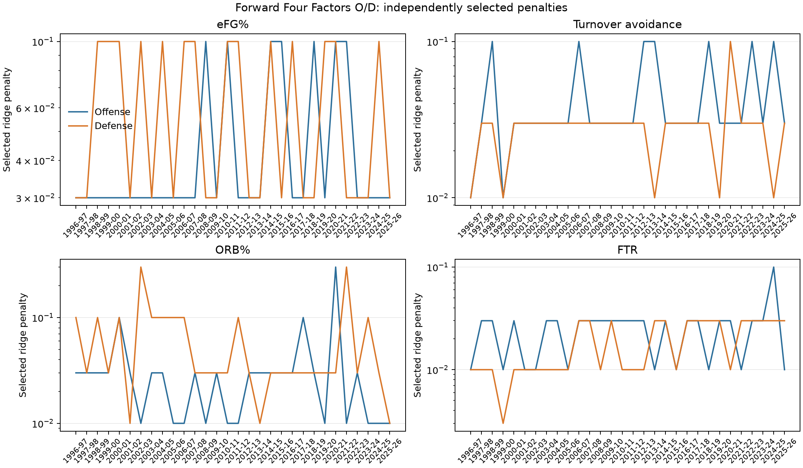
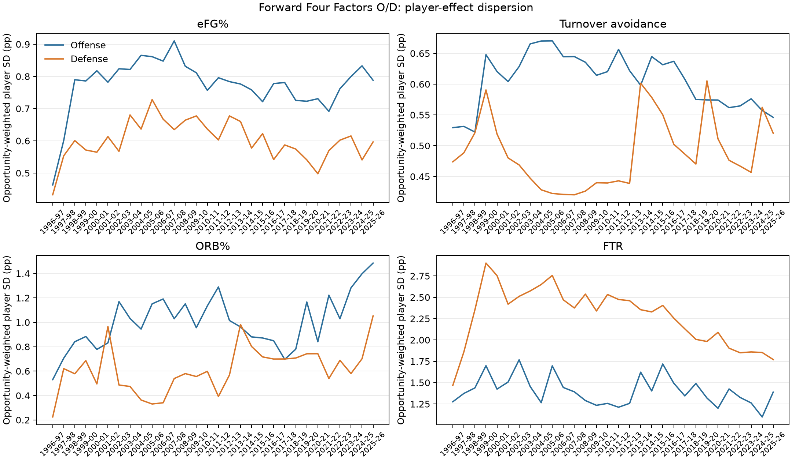
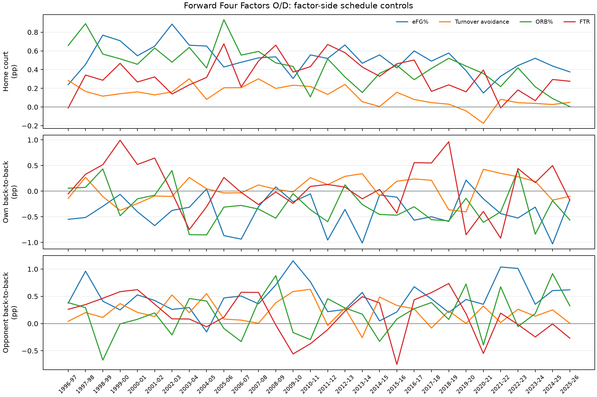

# Four Factors RAPM

This is a descriptive player-attribution layer built from Dean Oliver's Four
Factors. It does not change NAIL-RAPM, the public rankings, or the frozen
leaderboard. Its purpose is to separate a player's estimated association with
the mechanisms that usually determine scoring efficiency and possession value.

## Definitions

For each lineup stint and team side, the audited event mart calculates:

\[
\begin{aligned}
\mathrm{eFG\%} &= \frac{\mathrm{FGM}+0.5\,\mathrm{3PM}}{\mathrm{FGA}},\\
\mathrm{TOV\%} &= \frac{\mathrm{TOV}}{\mathrm{FGA}+0.44\,\mathrm{FTA}+\mathrm{TOV}},\\
\mathrm{ORB\%} &= \frac{\mathrm{ORB}}{\mathrm{ORB}+\mathrm{Opponent\ DRB}},\\
\mathrm{FTR} &= \frac{\mathrm{FTA}}{\mathrm{FGA}}.
\end{aligned}
\]

FTR is deliberately `FTA/FGA`, the historical Four Factors convention. The
mart is aligned to the canonical lineup-stint event boundaries and only admits
games whose play-by-play event points exactly reconcile to the final score.

## First Fit Contract

The initial fit estimates a separate **net** signed player effect for each
factor. For a factor rate \(r\), the target is \(r_H-r_A\). The player design
has `+1` for the home unit and `-1` for the away unit. Turnovers are presented
as **turnover avoidance**, so its fitted target is \(-\mathrm{TOV\%}_H -
(-\mathrm{TOV\%}_A)\); larger values are favorable for every displayed
component.

Each row is weighted by the harmonic opportunity of the two sides:

\[
w=\frac{n_H n_A}{n_H+n_A}.
\]

This is factor-specific: \(n\) is FGA for eFG% and FTR, usage opportunities
for TOV%, and offensive-rebound opportunities for ORB%. The weight reflects
the precision of a difference between two rates, rather than treating generic
possessions as the denominator for every mechanism.

Home-court advantage is the unpenalized intercept, and an unpenalized
home-minus-away back-to-back control is fitted jointly. Player coefficients
receive a sample-size-normalized ridge penalty. Lambda is selected separately
for each factor through the existing expanding chronological game folds; no
NAIL lambda, player prior, or context coefficient is reused.

Effects are published in percentage points of the factor rate. A positive
eFG%, turnover-avoidance, ORB%, or FTR effect is favorable. This stage is
completed-season descriptive attribution. The separate offensive and defensive
factor components, stability charts, and a frozen NAIL-prior test are recorded
below.

## Forward Factor-State Plan

The descriptive net fit is not the intended final player layer. The forward
contract uses the same prior-centered player-state principles as NAIL, but it
does **not** reuse a total NAIL rating or a NAIL context term. Instead, it
carries eight factor-side player states:

- eFG offense and eFG defense;
- turnover avoidance offense and forced-turnover defense;
- ORB offense and ORB defense; and
- FTR offense and FTR defense.

For a component \(k\), a season-\(t\) coefficient is centered on a strictly
available preseason state \(\mu_{i,k,t}\). Returning players receive a
component-specific aging forecast from their prior completed factor state.
Players returning after a gap are advanced one annual aging transition per
missing season from their last observed component state. Unseen players receive
an exposure-gated cold-start prior based on preseason information such as draft
capital, age, and position. Player states are league-zero-centered; factor
league levels remain in the intercepts and factor-specific home-court/back-to-
back controls.

For a positive-oriented component rate \(q\), the home and away observations
of each stint are fit jointly as

\[
\begin{aligned}
q_H &= c + h + \sum_{i\in H} o_i - \sum_{j\in A} d_j
      + b_{\mathrm{own}}\,\mathrm{B2B}_H
      + b_{\mathrm{opp}}\,\mathrm{B2B}_A,\\
q_A &= c - h + \sum_{i\in A} o_i - \sum_{j\in H} d_j
      + b_{\mathrm{own}}\,\mathrm{B2B}_A
      + b_{\mathrm{opp}}\,\mathrm{B2B}_H.
\end{aligned}
\]

The turnover target is \(-\mathrm{TOV\%}\), so both a positive offensive
coefficient (ball security) and a positive defensive coefficient (forcing
turnovers) are favorable. Each side row uses that side's native factor
opportunities as its weight. Intercept, home court, and own/opponent
back-to-back controls are unpenalized. The player objective has independent
offense and defense penalties, \(\lambda_{k,O}\) and \(\lambda_{k,D}\),
selected jointly through chronological folds. This allows e.g. offensive ORB
and defensive ORB to shrink by different amounts without borrowing a NAIL
constant.

The completed-season fit updates each forward state through this
prior-centered ridge. It does not include NAIL's additive profile or
non-additive lineup context terms: the Four Factors are the target mechanisms,
not another context residual layer.

## First Completed-Season Fit

The initial 2025-26 fit selected independent ridge values of `0.03` for eFG%,
turnover avoidance, and FTR, and `0.01` for ORB%. All are interior selections
from the registered `0` through `10` screening grid. The early leaders are
directionally sensible: Victor Wembanyama led the eFG component (+2.99 pp),
Shai Gilgeous-Alexander led turnover avoidance (+1.46 pp), Donovan Clingan led
ORB% (+7.48 pp), and Nikola Jokić led FTR (+4.13 pp). These are descriptive
completed-season estimates, not claims that a player will repeat the result or
that the four components should be summed into total NAIL.

The immutable 2025-26 artifact is
`artifacts/models/analysis/four_factor_rapm/2025-26/four-factor-rapm-2025-26-20260923T144522Z-0f16fedd`.
The identical historical pass through 2024-25 is
`artifacts/models/analysis/four_factor_rapm_history/four-factor-rapm-history-1996-97-to-2024-25-20260923T145204Z-18a98d54`.

## Forward O/D Diagnostics

The completed forward O/D state through 2025-26 is
`artifacts/models/analysis/forward_four_factor_offense_defense/2025-26/forward-four-factor-od-2025-26-20260924T062408Z-11a10c95`.
It contains 30 sequential completed seasons and 58,245 factor-side player
rows. The charts below are diagnostics for the estimation contract, not a
claim that any component should be summed directly into NAIL.

The player-effect dispersion is an opportunity-weighted standard deviation of
the completed player states. It describes how much separation the ridge fit is
actually retaining for each component and side in each season.

Finally, each factor fit has its own unpenalized schedule controls. This keeps
factor-specific home and short-rest effects out of player credit while allowing
their estimated values to vary by era and mechanism.

## Game-Level Reconciliation

The mechanism layer can be reconciled to observed game net rating without
reclassifying its residual as a player effect. A pooled, pace-weighted linear
accounting model uses the home-minus-away differentials in eFG%, turnover
avoidance, ORB%, and FTR to predict home net rating. Its fitted values are
about `+1.51`, `+1.36`, `+0.43`, and `+0.11` points per 100, respectively, for
a one-percentage-point differential. Those are joint accounting weights, not
standalone causal values: the factors covary within real games.

Across 1996-97 through 2025-26, the model explains 89.5% of unweighted
game-level net-rating variance. In 2025-26 its pace-weighted \(R^2\) is 91.6%
and its unexplained net-rating RMSE is 5.0 points per 100. The reconciliation
artifact is
`artifacts/models/analysis/four_factor_reconciliation/2025-26/four-factor-reconciliation-2025-26-20260924T062734Z-7983212d`.
The unexplained term is retained explicitly; it is not distributed across the
Four Factors player coefficients or imported into NAIL.

## Four Factors Attributed Player Rating

The web presentation translates each completed player factor-side effect into a
common points-per-100 scale using the pooled reconciliation weights. The
**Four Factors Attributed Player Rating (FFAPR)** is the descriptive total:

\[
\operatorname{FFAPR}_{i,t} = \sum_f w_f
\left(\theta^{O}_{i,f,t} + \theta^{D}_{i,f,t}\right),
\]

where the factor effects \(\theta\) are percentage points in their native
rates, defense is already oriented so positive is favorable, and \(w_f\) is
the corresponding joint game-reconciliation weight. Each player bio shows the
native percentage-point state, its translated component rating, and the summed
FFAPR.

FFAPR is comparable in units to completed NAIL, but it is **not a replacement
for NAIL**. It excludes the direct residual player signal and the NAIL
non-additive context model; the difference `NAIL - FFAPR` is therefore a
diagnostic of coverage by these four rate families, not a causal or exhaustive
value decomposition.

## Frozen NAIL Prior Test

We tested whether the eight forward factor-side player states could improve the
existing production NAIL player prior. This was deliberately a narrow test:
the NAIL player fit, residualized-target lambda selection, additive profiles,
two-feature non-additive context, and home-court/B2B treatment all remained
unchanged. Only the player prior received a possible adjustment.

For a completed NAIL season (s), the bridge learns the residual
(R_{i,s}-\mu_{i,s}) from the **previous** season's eight Four Factors O/D
states. Before target season (t), it trains only on completed seasons through
(t-1), then applies the (t-1) factor state to the already-established NAIL
prior \(\mu_{i,t}\). The bridge is a no-intercept Ridge on RMS-scaled factor
states, so a player without a completed source state receives exactly zero
adjustment. Its alpha is selected from `0.003` through `10` using three
expanding chronological completed-season validation folds.

The zero-weight implementation was run through all 30 seasons before scoring.
It reproduced production exactly: all 13,813 player-season priors, all 14,572
completed player coefficients, and every frozen possession and game prediction
had maximum absolute difference `0.0`.

| Metric, 2023-24 through 2025-26 | Production NAIL | Four Factors bridge |
| --- | ---: | ---: |
| Possession RMSE | **1.198147** | 1.198151 |
| Possession MAE | **1.141455** | 1.141457 |
| Eligible-game RMSE | **14.0051** | 14.0135 |
| Full-game RMSE | **14.2166** | 14.2268 |
| Winner accuracy | **68.30%** | 68.19% |
| Team net-rating RMSE | **3.2351** | 3.2636 |
| Pythagorean-win RMSE | **6.9423** | 6.9809 |

The candidate is **not promoted** and is not added to the public frozen
leaderboard. The factor-state effects remain useful as an explainability layer,
but this direct residual-bridge formulation adds no predictive value beyond
the production NAIL prior. The immutable candidate and paired frozen artifacts
are:

- `artifacts/models/forward_nail_four_factor_prior_bridge/2025-26/forward-nail-four-factor-prior-bridge-2025-26-20260924T072826Z-85f086cd`
- `artifacts/models/analysis/nail_four_factor_prior_bridge_frozen_backtest/frozen_multiseason_backtest/2023-24_to_2025-26/frozen_multiseason_backtest-2023-24-to-2025-26-20260924T073341Z-510daee0`

## Audited Source

The current mart covers 1996-97 through 2025-26. Of 34,610 regular-season
games, 34,508 (99.705%) reconcile exactly and are eligible. The remaining 102
games are explicitly excluded rather than assigning their missing or
nonreconciling events to player coefficients.
