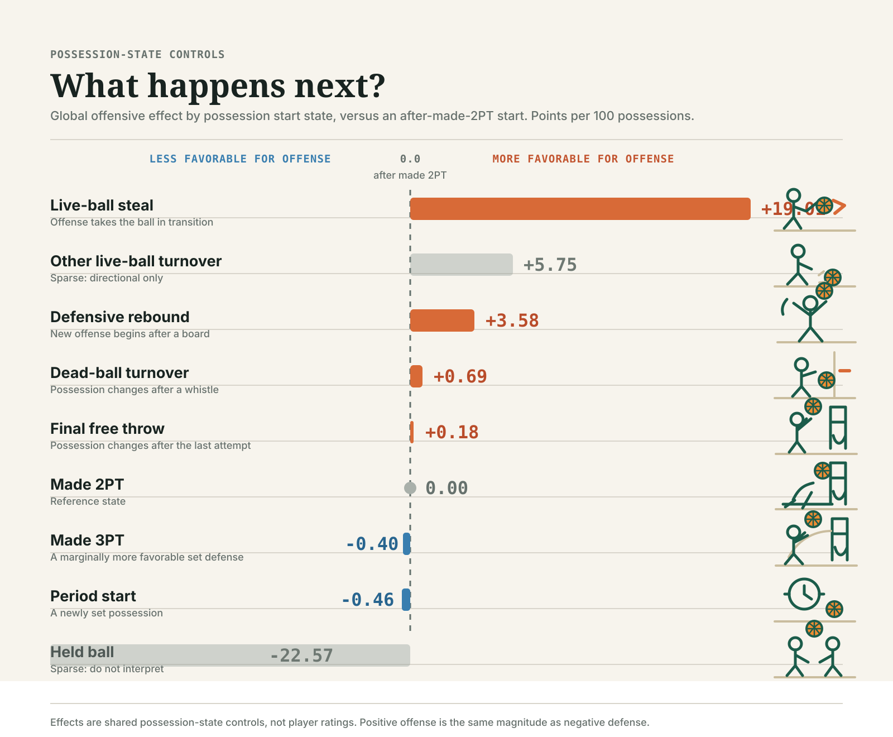

# Hierarchical Possession-State Screen

This follow-on to the [live/dead conditional screen](possession-state-screen.md)
asks whether the detailed start-state taxonomy contains player-specific signal
beyond the known coarse state. It remains an at-possession, realized-state
exercise layered on the exact frozen O/D Split NAIL baseline. It is not a
pregame leaderboard or ratings candidate.

## Hierarchy

The model uses three nested layers after fixed Split NAIL:

1. A granular state control for every non-fallback start state. Made 2PT is the
   reference control state.
2. A player O/D live-versus-dead contrast.
3. Player O/D contrasts for eligible granular states within their coarse
   parent.

For player (i), live state (L), and that player's source-window live/dead
exposures (n^L_i, n^D_i), the coarse feature is:

\[
x^{coarse}_{i,p} =
\begin{cases}
1 & L_p = 1 \\
-n^L_i / n^D_i & L_p = 0.
\end{cases}
\]

Its source-window, player-appearance-weighted sum is exactly zero. For a
granular child state (s) with coarse-parent anchor (a), the child contrast is
`+1` in (s), `-n_{i,s}/n_{i,a}` in (a), and zero elsewhere. That also sums to
zero for every represented player-side. Consequently, neither layer can
silently redefine total NAIL; it only reallocates a player's effect across
known possession-start contexts.

## Pooling And Support

Only states with at least `10,000` source single-lineup possessions are allowed
to receive player-specific child contrasts. Rarer states remain in the global
control layer only. The most common eligible state in each coarse family is its
anchor: defensive rebounds for live-ball states and made 2PT shots for
dead-ball states.

The parent live/dead terms retain the validated screen's relative precision of
`32`. Child terms are more strongly pooled, with their precision additionally
scaled by `max(anchor share / child-state share, 1)`. Development seasons select
the child base precision from `8, 16, 32, 64, 128, 256, 512`; a boundary winner
is rejected and requires an expanded grid before interpretation.

## Evaluation

Each target season is fit solely on the preceding four complete seasons.
Development targets are 2019-20 through 2022-23; 2023-24 through 2025-26 are
frozen. The artifact compares fixed O/D Split NAIL, fine state controls,
coarse player effects, and the complete hierarchy. It also writes game-cluster
bootstrap intervals, per-state source support and decisions, granular control
time series, and final-window player contrast diagnostics.

The realized possession state is not known pregame. Any incremental result can
justify an in-game conditional forecast only; a later state-generation model
would be required before treating it as pregame player attribution.

## Reproduce

```bash
uv run nba-run-hierarchical-possession-state-screen \
  --log-path artifacts/logs/hierarchical-possession-state-screen.log
```

## Result

The completed replay is
`artifacts/models/hierarchical_possession_state_screen/hierarchical-possession-state-screen-20260928T164414Z-f07fc836`.
Development selected child precision `256`, an interior grid value. The
frozen replay covers 623,970 known-state, single-lineup possessions from
2023-24 through 2025-26.

| Model | Conditional possession RMSE | Change vs. fixed O/D Split NAIL |
| --- | ---: | ---: |
| Fixed O/D Split NAIL | 121.52744 | -- |
| Fine state controls | 121.39066 | -0.13678 |
| Centered coarse player state | 121.41334 | -0.11410 |
| Full hierarchical fine state | 121.41375 | -0.11369 |

The granular player layer is `+0.00041` RMSE worse than its centered coarse
player control. Its game-cluster bootstrap interval is `[-0.00010, +0.00093]`
and only 5.9% of bootstrap draws favor the full hierarchy. The individual
frozen seasons are similarly flat or adverse: `+0.00078`, `+0.00001`, and
`+0.00044` RMSE versus the coarse-player control.

The decision is therefore **not to advance any granular player-specific state
term**. The result does not reverse the separate live/dead screen: that screen
uses its previously validated zero-at-dead-ball coordinate system. This test
uses stricter source-frequency centering to ensure that a player's granular
terms cannot redefine their total coordinate; within that contract, the
additional player granularity has no useful conditional signal.

| State | Support decision | Player-specific decision |
| --- | --- | --- |
| Defensive rebound | Live-ball anchor; 270,443 minimum source possessions | Anchor only; no child term to retain |
| Live-ball turnover with credited steal | 55,692 minimum source possessions | Tested; do not advance |
| Other live-ball turnover | 491 minimum source possessions | Control only; too sparse |
| Made 2PT | Dead-ball anchor; 206,151 minimum source possessions | Anchor only; no child term to retain |
| Made 3PT | 86,436 minimum source possessions | Tested; do not advance |
| Final free throw | 72,271 minimum source possessions | Tested; do not advance |
| Dead-ball turnover | 31,494 minimum source possessions | Tested; do not advance |
| Period start | 17,232 minimum source possessions | Tested; do not advance |
| Held ball | 18 minimum source possessions | Control only; too sparse |

The stable global start-state controls remain useful descriptive evidence. In
particular, a possession after a credited live-ball steal is roughly `+15` per
100 possessions relative to the made-2PT reference in each frozen-source fit.
That is a state effect, however, not evidence that a stable player-specific
residual should be attributed to the ten players on the floor.

## Global State Effects


