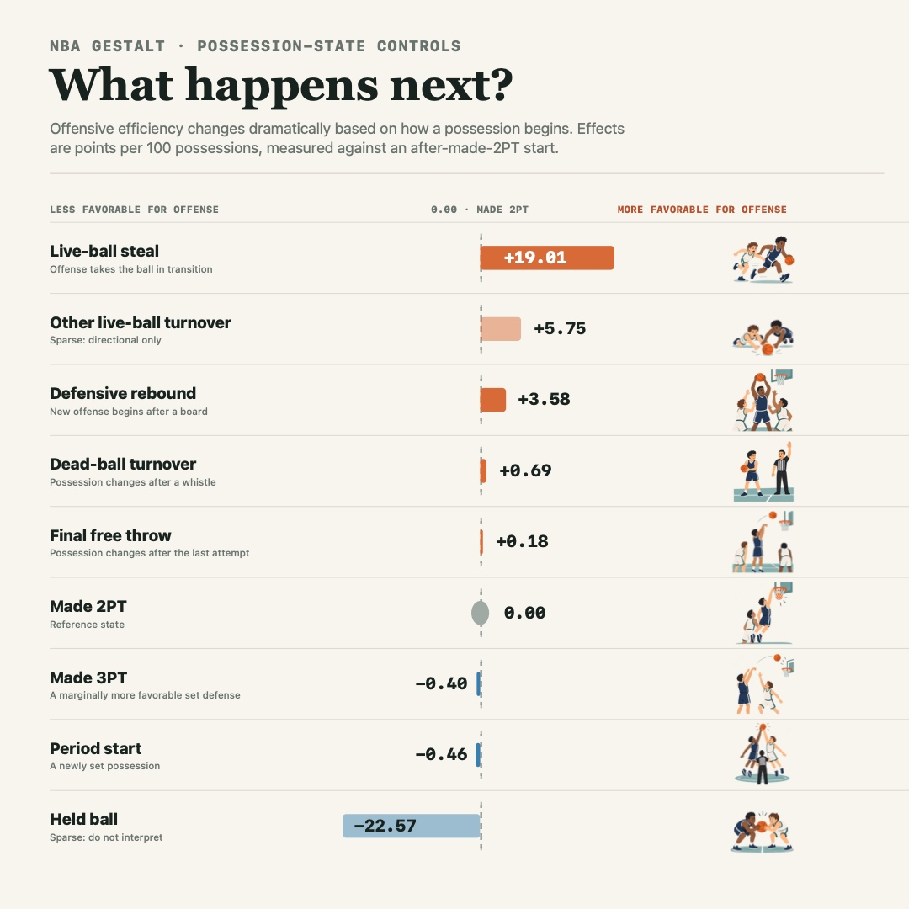

# Possession Start-State Study

This study asks a straightforward question: once the ten players on the floor
are held fixed, how much does the state that begins an NBA possession change
the expected outcome? It is a realized in-game conditioning exercise, not a
pregame player-rating candidate. The possession start state is unknown until
the prior possession has ended.

The taxonomy is built in the [possession start-state mart](../data/possession-start-states.md).
Each row is a known-state, single-lineup possession. Its target is the
observed offensive points per 100 possessions, and its baseline is the frozen
O/D Split NAIL prediction for the exact ten-player lineup.

## Global Effects

The global controls are estimated with a weighted least-squares regression of
the residual from frozen Split NAIL on start-state indicators. Made 2PT is the
reference state. These are **state effects**, not player ratings: a positive
offensive effect has the same magnitude as a negative defensive effect.

The extreme transition effect after a credited live-ball steal is mechanically
plausible: the new offense often attacks before the defense can organize.
`Other live-ball turnover` and `held ball` are sparse in the final source
window and are intentionally displayed as directional context only.

## Evaluation

Every target season is fit only on the preceding four complete seasons.
Development targets are 2019-20 through 2022-23, while 2023-24 through
2025-26 remain frozen. The granular replay covers 623,970 known-state,
single-lineup frozen possessions.

| Model | Conditional possession RMSE | Change vs. fixed O/D Split NAIL |
| --- | ---: | ---: |
| Fixed O/D Split NAIL | 121.52744 | -- |
| Fine start-state controls | 121.39066 | -0.13678 |
| Centered coarse player-state effects | 121.41334 | -0.11410 |
| Full hierarchical fine player-state effects | 121.41375 | -0.11369 |

The global state controls improve the conditional prediction. The granular
player-specific layer does not: it is `+0.00041` RMSE worse than the centered
coarse player-state model, with a game-cluster bootstrap interval of
`[-0.00010, +0.00093]`. It therefore is not advanced.

## Components

- [Live/dead conditional screen](possession-state-screen.md): validates the
  coarse realized-state control and its strongly pooled player interaction.
- [Hierarchical possession-state screen](hierarchical-possession-state-screen.md):
  tests granular player-specific deviations within each coarse state family.
- [Possession start-state mart](../data/possession-start-states.md): documents
  the exhaustive start-state taxonomy and source data contract.
