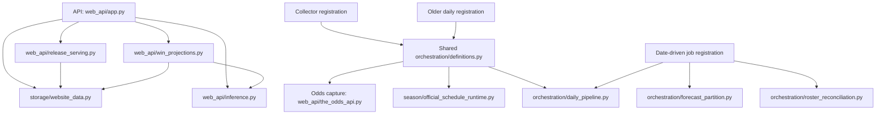

# Source code map

Plain-English descriptions and code dependencies for the Python modules under `src/nba_lineup_model`. The full `modeling/` inventory is intentionally omitted; the separate `models/` folder is included. References to `modeling/` modules are retained in expandable lists so real dependencies are not hidden.

**Scope:** 202 documented modules in 16 folder groups. Dependency analysis reads all 462 Python modules in this package to find reverse references, but does not inventory files elsewhere in the repository.

## How to read this map

- **Depends on** lists direct internal module imports and explicitly identified module launches.
- **Used by** is the reverse: modules with a direct import or launch relationship to this module. It is not a list of individual function callers.
- **On-demand import** means the import appears inside a function; it may execute only for particular jobs, endpoints, or error paths. **Types only** means the import is guarded by `TYPE_CHECKING` and is excluded from runtime reach.
- **Entry-point reach** means a path exists through imports or explicit launches from that entrypoint. It does not prove a module executes on every request, is currently running, or is part of a particular job.
- External libraries, implicit parent-package initialization, file/data reads, dependency injection, and module names supplied through external configuration are not represented as edges. Launch relationships are included where explicitly verified in this source.
- **None found** does not mean a module is unused: it may be invoked from outside this package, through a command-line entrypoint, or by deployment configuration.
- An **artifact** is a saved output with identifying metadata; **frozen** means an earlier saved state is kept fixed. NAIL and HPM are project names for player/lineup rating models.

## Start here: important application paths

These are practical starting points for understanding the application, not a claim that every other module is optional. A module can be important for data correctness even if few other modules import it.

| Area | Start with | Why it matters |
| --- | --- | --- |
| Website requests | [web_api/app.py](web_api/app.py) | Defines the public API routes and connects requests to serving helpers. |
| Website data loading | [web_api/release_serving.py](web_api/release_serving.py), [storage/website_data.py](storage/website_data.py), [season/serving_selection.py](season/serving_selection.py) | Resolves the selected release and loads the exact saved inputs the website uses. |
| Website calculations | [web_api/win_projections.py](web_api/win_projections.py), [web_api/inference.py](web_api/inference.py) | Contains existing game/team projections and Lineup Lab inference; these are calculation dependencies, not merely display code. |
| Collector registration | [orchestration/collection_definitions.py](orchestration/collection_definitions.py), [orchestration/definitions.py](orchestration/definitions.py) | Registers the existing injury/schedule, odds, and live-score jobs and connects them to their implementations. |
| Collector implementation | [web_api/the_odds_api.py](web_api/the_odds_api.py), [season/official_schedule_runtime.py](season/official_schedule_runtime.py) | Captures market odds and official schedule/live-result data; the odds collector currently lives under web_api despite its collection role. |
| Daily processing | [orchestration/daily_pipeline.py](orchestration/daily_pipeline.py), [orchestration/resumable_pipeline.py](orchestration/resumable_pipeline.py), [orchestration/forward_daily.py](orchestration/forward_daily.py) | Coordinates observed-data, model, and serving preparation and resumable daily work. |
| Date-driven job registration | [orchestration/partition_definitions.py](orchestration/partition_definitions.py) | Registers daily, forecast, and reconciliation jobs using custom dated work requests, not native Dagster asset partitions. |
| Forecast publication | [orchestration/forecast_partition.py](orchestration/forecast_partition.py), [orchestration/forecast_publication_workflow.py](orchestration/forecast_publication_workflow.py), [season/forecast_publication.py](season/forecast_publication.py) | Selects dated inputs, prepares forecasts, and publishes their selections. |
| Daily input/model history | [season/daily_data_replay.py](season/daily_data_replay.py), [season/daily_model_replay.py](season/daily_model_replay.py), [season/daily_data_artifact.py](season/daily_data_artifact.py), [season/daily_model_artifact.py](season/daily_model_artifact.py) | Defines and builds the data and model checkpoints used by downstream products. |
| New-player handling | [orchestration/roster_reconciliation.py](orchestration/roster_reconciliation.py), [players/reconciliation_workflow.py](players/reconciliation_workflow.py), [players/in_season_rosters.py](players/in_season_rosters.py) | Coordinates roster evidence and initialization of newly introduced players. |
| Release activation | [season/release_publisher.py](season/release_publisher.py), [orchestration/daily_activation.py](orchestration/daily_activation.py) | Controls which prepared release becomes live and handles activation or rollback. |

## Selected dependency graph

Arrows mean “depends on this module.” This is a simplified view of verified direct code relationships, not a Dagster asset graph or an execution timeline.

**Important overlap:** collector registration and older daily registration import the same `definitions.py`, which contains multiple kinds of jobs and on-demand imports. Daily validation also launches the website API. These connections make transitive reach much broader than the code a single odds poll or HTTP request actually executes.

## Shared modules with many direct users

These counts identify places where changes can affect many modules. They include research/experiment imports from `modeling/`, so they measure code coupling rather than production traffic or operational priority.

| Module | Direct users in this package |
| --- | ---: |
| [season/schema.py](season/schema.py) | 79 |
| [season/daily_artifact_common.py](season/daily_artifact_common.py) | 29 |
| [tracking.py](tracking.py) | 28 |
| [models/baselines.py](models/baselines.py) | 26 |
| [web_api/inference.py](web_api/inference.py) | 23 |
| [ingest/nba_cdn.py](ingest/nba_cdn.py) | 21 |
| [evaluation/metrics.py](evaluation/metrics.py) | 18 |
| [orchestration/daily_work.py](orchestration/daily_work.py) | 18 |
| [storage/website_data.py](storage/website_data.py) | 17 |
| [season/storage.py](season/storage.py) | 16 |
| [season/daily_model_artifact.py](season/daily_model_artifact.py) | 15 |
| [season/serving_selection.py](season/serving_selection.py) | 15 |

## Folder index

- [Package root](#package-root) — 3 modules.
- [audit/](#audit) — 10 modules.
- [evaluation/](#evaluation) — 2 modules.
- [events/](#events) — 3 modules.
- [flows/](#flows) — 7 modules.
- [ingest/](#ingest) — 4 modules.
- [lineups/](#lineups) — 2 modules.
- [models/](#models) — 6 modules.
- [normalize/](#normalize) — 4 modules.
- [orchestration/](#orchestration) — 27 modules.
- [players/](#players) — 16 modules.
- [possessions/](#possessions) — 4 modules.
- [rotation/](#rotation) — 27 modules.
- [season/](#season) — 52 modules.
- [storage/](#storage) — 9 modules.
- [web_api/](#web_api) — 26 modules.

## Package root

Package entrypoints, single-game reconstruction, and experiment tracking.

### [__init__.py](__init__.py)

Marks the main NBA lineup modeling package and describes its purpose.

- **Entry-point reach:** No path found from the selected API, Dagster, or Prefect entrypoints..
- **Depends on:** None found within this package.
- **Used by:** None found within this package.

### [build_game.py](build_game.py)

Turns a game's raw NBA data into reconstructed events, lineups, and possessions, then saves the resulting tables.

- **Entry-point reach:** API, Collectors, Daily registration, Date-driven jobs, Prefect workflows.
- **Depends on:** [events/__init__.py](events/__init__.py), [events/schema.py](events/schema.py), [ingest/nba_cdn.py](ingest/nba_cdn.py), [lineups/__init__.py](lineups/__init__.py), [normalize/boxscore.py](normalize/boxscore.py), [possessions/__init__.py](possessions/__init__.py), [season/source.py](season/source.py) (on-demand import)
- **Used by:** [audit/history.py](audit/history.py), [audit/runner.py](audit/runner.py), [season/process.py](season/process.py)

Used by: 1 references into the omitted modeling/ folder

- [modeling/in_season_nail_monitor.py](modeling/in_season_nail_monitor.py)

### [tracking.py](tracking.py)

Records completed experiments and their saved outputs in the configured experiment-tracking system.

- **Entry-point reach:** API, Collectors, Daily registration, Date-driven jobs, Prefect workflows.
- **Depends on:** None found within this package.
- **Used by:** [flows/backfill_history.py](flows/backfill_history.py)

Used by: 27 references into the omitted modeling/ folder

- [modeling/aging.py](modeling/aging.py) (on-demand import)
- [modeling/aging_prior_rapm.py](modeling/aging_prior_rapm.py) (on-demand import)
- [modeling/bayesian.py](modeling/bayesian.py) (on-demand import)
- [modeling/blended_prior_rapm.py](modeling/blended_prior_rapm.py) (on-demand import)
- [modeling/box_score_rapm.py](modeling/box_score_rapm.py) (on-demand import)
- [modeling/catboost.py](modeling/catboost.py) (on-demand import)
- [modeling/cold_start_exposure.py](modeling/cold_start_exposure.py) (on-demand import)
- [modeling/cold_start_rapm.py](modeling/cold_start_rapm.py) (on-demand import)
- [modeling/combined_box_score_prior_rapm.py](modeling/combined_box_score_prior_rapm.py) (on-demand import)
- [modeling/deep_sets.py](modeling/deep_sets.py) (on-demand import)
- [modeling/draft_prior.py](modeling/draft_prior.py) (on-demand import)
- [modeling/era_comparison.py](modeling/era_comparison.py)
- [modeling/exposure_gated_cold_start.py](modeling/exposure_gated_cold_start.py) (on-demand import)
- [modeling/exposure_gated_offense_defense.py](modeling/exposure_gated_offense_defense.py) (on-demand import)
- [modeling/forward_calibration.py](modeling/forward_calibration.py)
- [modeling/forward_complete_player_prior_baseline.py](modeling/forward_complete_player_prior_baseline.py) (on-demand import)
- [modeling/forward_rapm_memory_baselines.py](modeling/forward_rapm_memory_baselines.py) (on-demand import)
- [modeling/frozen_prior_evaluation.py](modeling/frozen_prior_evaluation.py) (on-demand import)
- [modeling/frozen_window_rapm.py](modeling/frozen_window_rapm.py) (on-demand import)
- [modeling/leaderboard.py](modeling/leaderboard.py) (on-demand import)
- [modeling/neural.py](modeling/neural.py) (on-demand import)
- [modeling/offense_defense_rapm.py](modeling/offense_defense_rapm.py) (on-demand import)
- [modeling/prior_rapm.py](modeling/prior_rapm.py) (on-demand import)
- [modeling/replacement_level.py](modeling/replacement_level.py) (on-demand import)
- [modeling/replacement_token.py](modeling/replacement_token.py) (on-demand import)
- [modeling/train.py](modeling/train.py) (on-demand import)
- [modeling/transformer.py](modeling/transformer.py) (on-demand import)

## audit/

Checks game reconstruction and historical input coverage.

### [__init__.py](audit/__init__.py)

Introduces the tools for checking reconstruction across seasons.

- **Entry-point reach:** Prefect workflows.
- **Depends on:** [audit/runner.py](audit/runner.py), [audit/sample.py](audit/sample.py), [audit/schema.py](audit/schema.py)
- **Used by:** [season/process.py](season/process.py)

### [external_game_rotation_import.py](audit/external_game_rotation_import.py)

Imports a supplied Game Rotation CSV into the raw-data cache so reconstruction can use it.

- **Entry-point reach:** No path found from the selected API, Dagster, or Prefect entrypoints..
- **Depends on:** [audit/game_rotation_probe.py](audit/game_rotation_probe.py), [ingest/nba_stats.py](ingest/nba_stats.py), [season/schema.py](season/schema.py), [season/storage.py](season/storage.py)
- **Used by:** None found within this package.

### [game_rotation_fetch.py](audit/game_rotation_fetch.py)

Downloads official Game Rotation evidence for games whose period lineups remain unresolved.

- **Entry-point reach:** No path found from the selected API, Dagster, or Prefect entrypoints..
- **Depends on:** [audit/game_rotation_probe.py](audit/game_rotation_probe.py), [flows/fetch_stats_history.py](flows/fetch_stats_history.py), [ingest/nba_stats.py](ingest/nba_stats.py), [season/schema.py](season/schema.py), [season/storage.py](season/storage.py)
- **Used by:** None found within this package.

### [game_rotation_probe.py](audit/game_rotation_probe.py)

Checks whether the NBA has Game Rotation data for games with lineup reconstruction failures.

- **Entry-point reach:** No path found from the selected API, Dagster, or Prefect entrypoints..
- **Depends on:** [flows/fetch_stats_history.py](flows/fetch_stats_history.py), [ingest/nba_stats.py](ingest/nba_stats.py), [season/schema.py](season/schema.py), [season/storage.py](season/storage.py)
- **Used by:** [audit/external_game_rotation_import.py](audit/external_game_rotation_import.py), [audit/game_rotation_fetch.py](audit/game_rotation_fetch.py), [audit/game_rotation_recovery.py](audit/game_rotation_recovery.py)

### [game_rotation_recovery.py](audit/game_rotation_recovery.py)

Retries failed game reconstruction using Game Rotation evidence already in the cache.

- **Entry-point reach:** No path found from the selected API, Dagster, or Prefect entrypoints..
- **Depends on:** [audit/game_rotation_probe.py](audit/game_rotation_probe.py), [flows/process_season.py](flows/process_season.py), [ingest/nba_stats.py](ingest/nba_stats.py), [season/schema.py](season/schema.py), [season/storage.py](season/storage.py)
- **Used by:** None found within this package.

### [history.py](audit/history.py)

Runs repeatable checks against the historical raw game data retained on disk.

- **Entry-point reach:** No path found from the selected API, Dagster, or Prefect entrypoints..
- **Depends on:** [audit/runner.py](audit/runner.py), [audit/schema.py](audit/schema.py), [build_game.py](build_game.py), [season/schema.py](season/schema.py), [season/source.py](season/source.py), [season/storage.py](season/storage.py)
- **Used by:** None found within this package.

### [modeling_coverage.py](audit/modeling_coverage.py)

Compares available historical rating-model inputs with the game catalog and saves a coverage report.

- **Entry-point reach:** No path found from the selected API, Dagster, or Prefect entrypoints..
- **Depends on:** None found within this package.
- **Used by:** None found within this package.

### [runner.py](audit/runner.py)

Runs reconstruction checks for selected games and collects the results into audit tables.

- **Entry-point reach:** API, Collectors, Daily registration, Date-driven jobs, Prefect workflows.
- **Depends on:** [audit/schema.py](audit/schema.py), [build_game.py](build_game.py), [ingest/nba_cdn.py](ingest/nba_cdn.py), [possessions/__init__.py](possessions/__init__.py)
- **Used by:** [audit/__init__.py](audit/__init__.py), [audit/history.py](audit/history.py), [season/storage.py](season/storage.py)

### [sample.py](audit/sample.py)

Selects a sample of games and writes the list used to run a reconstruction audit.

- **Entry-point reach:** Prefect workflows.
- **Depends on:** [audit/schema.py](audit/schema.py)
- **Used by:** [audit/__init__.py](audit/__init__.py)

### [schema.py](audit/schema.py)

Defines the records for requested audit games, audit manifests, and individual game results.

- **Entry-point reach:** API, Collectors, Daily registration, Date-driven jobs, Prefect workflows.
- **Depends on:** [ingest/nba_cdn.py](ingest/nba_cdn.py)
- **Used by:** [audit/__init__.py](audit/__init__.py), [audit/history.py](audit/history.py), [audit/runner.py](audit/runner.py), [audit/sample.py](audit/sample.py), [season/schema.py](season/schema.py)

## evaluation/

Measures prediction accuracy.

### [__init__.py](evaluation/__init__.py)

Introduces the model-evaluation helpers.

- **Entry-point reach:** No path found from the selected API, Dagster, or Prefect entrypoints..
- **Depends on:** None found within this package.
- **Used by:** None found within this package.

### [metrics.py](evaluation/metrics.py)

Calculates prediction-error measures, including game-margin error and improvement over a baseline.

- **Entry-point reach:** API, Collectors, Daily registration, Date-driven jobs, Prefect workflows.
- **Depends on:** None found within this package.
- **Used by:** Only `modeling/` references below.

Used by: 18 references into the omitted modeling/ folder

- [modeling/aging_prior_rapm.py](modeling/aging_prior_rapm.py)
- [modeling/bayesian.py](modeling/bayesian.py)
- [modeling/catboost.py](modeling/catboost.py)
- [modeling/contextual_prior.py](modeling/contextual_prior.py)
- [modeling/deep_sets.py](modeling/deep_sets.py)
- [modeling/diagnostics.py](modeling/diagnostics.py)
- [modeling/draft_prior.py](modeling/draft_prior.py)
- [modeling/exposure_gated_offense_defense.py](modeling/exposure_gated_offense_defense.py)
- [modeling/frozen_multiseason_backtest.py](modeling/frozen_multiseason_backtest.py)
- [modeling/frozen_prior_evaluation.py](modeling/frozen_prior_evaluation.py)
- [modeling/frozen_window_rapm.py](modeling/frozen_window_rapm.py)
- [modeling/leaderboard.py](modeling/leaderboard.py)
- [modeling/neural.py](modeling/neural.py)
- [modeling/offense_defense_rapm.py](modeling/offense_defense_rapm.py)
- [modeling/prior_rapm.py](modeling/prior_rapm.py)
- [modeling/profile_deep_sets_backtest.py](modeling/profile_deep_sets_backtest.py)
- [modeling/train.py](modeling/train.py)
- [modeling/transformer.py](modeling/transformer.py)

## events/

Defines and normalizes basketball events.

### [__init__.py](events/__init__.py)

Introduces the shared representation of basketball events.

- **Entry-point reach:** API, Collectors, Daily registration, Date-driven jobs, Prefect workflows.
- **Depends on:** [events/normalize.py](events/normalize.py), [events/schema.py](events/schema.py)
- **Used by:** [build_game.py](build_game.py)

### [normalize.py](events/normalize.py)

Converts NBA play-by-play into consistent event records and handles game-clock calculations.

- **Entry-point reach:** API, Collectors, Daily registration, Date-driven jobs, Prefect workflows.
- **Depends on:** [events/schema.py](events/schema.py)
- **Used by:** [events/__init__.py](events/__init__.py), [lineups/reconstruct.py](lineups/reconstruct.py) (on-demand import)

Used by: 1 references into the omitted modeling/ folder

- [modeling/in_season_minutes_monitor.py](modeling/in_season_minutes_monitor.py)

### [schema.py](events/schema.py)

Defines the fields of a normalized basketball event.

- **Entry-point reach:** API, Collectors, Daily registration, Date-driven jobs, Prefect workflows.
- **Depends on:** None found within this package.
- **Used by:** [build_game.py](build_game.py), [events/__init__.py](events/__init__.py), [events/normalize.py](events/normalize.py), [lineups/reconstruct.py](lineups/reconstruct.py), [possessions/reconstruct.py](possessions/reconstruct.py), [possessions/segments.py](possessions/segments.py)

## flows/

Prefect workflows for historical downloads and processing.

### [__init__.py](flows/__init__.py)

Introduces the Prefect workflow entrypoints that coexist with the Dagster code.

- **Entry-point reach:** No path found from the selected API, Dagster, or Prefect entrypoints..
- **Depends on:** None found within this package.
- **Used by:** None found within this package.

### [backfill_history.py](flows/backfill_history.py)

Coordinates the stages needed to download and process historical seasons, recording their outcomes.

- **Entry-point reach:** Prefect workflows.
- **Depends on:** [flows/compact_season.py](flows/compact_season.py), [flows/fetch_season.py](flows/fetch_season.py), [flows/process_season.py](flows/process_season.py), [ingest/nba_cdn.py](ingest/nba_cdn.py), [players/collect.py](players/collect.py), [season/schedule.py](season/schedule.py), [season/schema.py](season/schema.py), [season/storage.py](season/storage.py), [tracking.py](tracking.py)

Depends on: 1 references into the omitted modeling/ folder

- [modeling/train.py](modeling/train.py)

- **Used by:** None found within this package.

### [compact_season.py](flows/compact_season.py)

Runs season-level work that combines smaller processed files into larger curated datasets.

- **Entry-point reach:** Prefect workflows.
- **Depends on:** [season/compact.py](season/compact.py), [season/fetch.py](season/fetch.py), [season/layout.py](season/layout.py), [season/process.py](season/process.py), [season/storage.py](season/storage.py)
- **Used by:** [flows/backfill_history.py](flows/backfill_history.py), [flows/recover_modeling_coverage.py](flows/recover_modeling_coverage.py)

### [fetch_season.py](flows/fetch_season.py)

Runs season-level downloads of raw NBA game data with retry handling.

- **Entry-point reach:** Prefect workflows.
- **Depends on:** [ingest/nba_cdn.py](ingest/nba_cdn.py), [season/fetch.py](season/fetch.py), [season/schema.py](season/schema.py), [season/storage.py](season/storage.py)
- **Used by:** [flows/backfill_history.py](flows/backfill_history.py)

### [fetch_stats_history.py](flows/fetch_stats_history.py)

Downloads historical NBA Stats endpoint responses, including the V3 inputs used by historical processing.

- **Entry-point reach:** Prefect workflows.
- **Depends on:** [ingest/nba_cdn.py](ingest/nba_cdn.py), [ingest/nba_stats.py](ingest/nba_stats.py), [season/fetch.py](season/fetch.py), [season/schema.py](season/schema.py), [season/stats.py](season/stats.py), [season/storage.py](season/storage.py)
- **Used by:** [audit/game_rotation_fetch.py](audit/game_rotation_fetch.py), [audit/game_rotation_probe.py](audit/game_rotation_probe.py)

### [process_season.py](flows/process_season.py)

Processes a season's raw games into reconstructed datasets and records successes and failures.

- **Entry-point reach:** Prefect workflows.
- **Depends on:** [season/fetch.py](season/fetch.py), [season/process.py](season/process.py), [season/schema.py](season/schema.py), [season/storage.py](season/storage.py)
- **Used by:** [audit/game_rotation_recovery.py](audit/game_rotation_recovery.py), [flows/backfill_history.py](flows/backfill_history.py), [flows/recover_modeling_coverage.py](flows/recover_modeling_coverage.py)

### [recover_modeling_coverage.py](flows/recover_modeling_coverage.py)

Finds catalog games missing from historical rating-model inputs and runs recovery for them.

- **Entry-point reach:** Prefect workflows.
- **Depends on:** [flows/compact_season.py](flows/compact_season.py), [flows/process_season.py](flows/process_season.py), [season/fetch.py](season/fetch.py), [season/storage.py](season/storage.py)

Depends on: 1 references into the omitted modeling/ folder

- [modeling/stints.py](modeling/stints.py)

- **Used by:** None found within this package.

## ingest/

Official NBA download clients and caches.

### [__init__.py](ingest/__init__.py)

Introduces direct downloads from official NBA data sources.

- **Entry-point reach:** No path found from the selected API, Dagster, or Prefect entrypoints..
- **Depends on:** [ingest/nba_cdn.py](ingest/nba_cdn.py), [ingest/nba_stats.py](ingest/nba_stats.py)
- **Used by:** None found within this package.

### [fetch_game.py](ingest/fetch_game.py)

Provides a command-line entrypoint for downloading one game's raw NBA data.

- **Entry-point reach:** No path found from the selected API, Dagster, or Prefect entrypoints..
- **Depends on:** [ingest/nba_cdn.py](ingest/nba_cdn.py)
- **Used by:** None found within this package.

### [nba_cdn.py](ingest/nba_cdn.py)

Fetches official NBA CDN responses and manages request pacing, caching, and source metadata.

- **Entry-point reach:** API, Collectors, Daily registration, Date-driven jobs, Prefect workflows.
- **Depends on:** None found within this package.
- **Used by:** [audit/runner.py](audit/runner.py), [audit/schema.py](audit/schema.py), [build_game.py](build_game.py), [flows/backfill_history.py](flows/backfill_history.py), [flows/fetch_season.py](flows/fetch_season.py), [flows/fetch_stats_history.py](flows/fetch_stats_history.py), [ingest/__init__.py](ingest/__init__.py), [ingest/fetch_game.py](ingest/fetch_game.py), [ingest/nba_stats.py](ingest/nba_stats.py), [players/opening_rosters.py](players/opening_rosters.py), [rotation/l1_minute_share_persistence.py](rotation/l1_minute_share_persistence.py), [season/backfill_recovery.py](season/backfill_recovery.py), [season/cdn_lake.py](season/cdn_lake.py), [season/daily_data_replay.py](season/daily_data_replay.py), [season/fetch.py](season/fetch.py), [season/official_schedule_runtime.py](season/official_schedule_runtime.py), [season/schema.py](season/schema.py), [season/source.py](season/source.py), [season/stats.py](season/stats.py), [season/stats_v3_lake.py](season/stats_v3_lake.py)

Used by: 1 references into the omitted modeling/ folder

- [modeling/in_season_minutes_monitor.py](modeling/in_season_minutes_monitor.py)

### [nba_stats.py](ingest/nba_stats.py)

Fetches official NBA Stats responses and manages request pacing, caching, and source metadata.

- **Entry-point reach:** API, Collectors, Daily registration, Date-driven jobs, Prefect workflows.
- **Depends on:** [ingest/nba_cdn.py](ingest/nba_cdn.py)
- **Used by:** [audit/external_game_rotation_import.py](audit/external_game_rotation_import.py), [audit/game_rotation_fetch.py](audit/game_rotation_fetch.py), [audit/game_rotation_probe.py](audit/game_rotation_probe.py), [audit/game_rotation_recovery.py](audit/game_rotation_recovery.py), [flows/fetch_stats_history.py](flows/fetch_stats_history.py), [ingest/__init__.py](ingest/__init__.py), [rotation/l1_minute_share_persistence.py](rotation/l1_minute_share_persistence.py), [season/source.py](season/source.py), [season/stats.py](season/stats.py), [season/stats_v3_lake.py](season/stats_v3_lake.py)

## lineups/

Reconstructs players on court.

### [__init__.py](lineups/__init__.py)

Introduces the lineup reconstruction tools.

- **Entry-point reach:** API, Collectors, Daily registration, Date-driven jobs, Prefect workflows.
- **Depends on:** [lineups/reconstruct.py](lineups/reconstruct.py)
- **Used by:** [build_game.py](build_game.py)

Used by: 1 references into the omitted modeling/ folder

- [modeling/in_season_nail_monitor.py](modeling/in_season_nail_monitor.py)

### [reconstruct.py](lineups/reconstruct.py)

Reconstructs which five players were on court for each team and identifies stretches with unchanged lineups.

- **Entry-point reach:** API, Collectors, Daily registration, Date-driven jobs, Prefect workflows.
- **Depends on:** [events/normalize.py](events/normalize.py) (on-demand import), [events/schema.py](events/schema.py)
- **Used by:** [lineups/__init__.py](lineups/__init__.py), [possessions/segments.py](possessions/segments.py)

Used by: 1 references into the omitted modeling/ folder

- [modeling/in_season_minutes_monitor.py](modeling/in_season_minutes_monitor.py)

## models/

Reusable model implementations; this is separate from the omitted modeling/ folder.

### [__init__.py](models/__init__.py)

Introduces reusable model implementations and simple comparison models.

- **Entry-point reach:** No path found from the selected API, Dagster, or Prefect entrypoints..
- **Depends on:** None found within this package.
- **Used by:** None found within this package.

### [baselines.py](models/baselines.py)

Implements mean predictions and lineup-based player-rating models, including versions centered on prior player estimates.

- **Entry-point reach:** API, Collectors, Daily registration, Date-driven jobs, Prefect workflows.
- **Depends on:** None found within this package.
- **Used by:** Only `modeling/` references below.

Used by: 26 references into the omitted modeling/ folder

- [modeling/aging_prior_rapm.py](modeling/aging_prior_rapm.py)
- [modeling/bayesian.py](modeling/bayesian.py)
- [modeling/blended_prior_rapm.py](modeling/blended_prior_rapm.py)
- [modeling/causal_hca.py](modeling/causal_hca.py)
- [modeling/combined_box_score_prior_rapm.py](modeling/combined_box_score_prior_rapm.py)
- [modeling/context_reattributed_rapm.py](modeling/context_reattributed_rapm.py)
- [modeling/diagnostics.py](modeling/diagnostics.py)
- [modeling/exposure_gated_offense_defense.py](modeling/exposure_gated_offense_defense.py)
- [modeling/forward_portable_matchup_contextual_rapm.py](modeling/forward_portable_matchup_contextual_rapm.py)
- [modeling/forward_split_nail.py](modeling/forward_split_nail.py)
- [modeling/forward_split_nail_v01.py](modeling/forward_split_nail_v01.py)
- [modeling/four_factor_rapm.py](modeling/four_factor_rapm.py)
- [modeling/frozen_window_rapm.py](modeling/frozen_window_rapm.py)
- [modeling/hierarchical_possession_state_screen.py](modeling/hierarchical_possession_state_screen.py)
- [modeling/in_season_nail.py](modeling/in_season_nail.py)
- [modeling/in_season_nail_calibration.py](modeling/in_season_nail_calibration.py)
- [modeling/offense_defense_rapm.py](modeling/offense_defense_rapm.py)
- [modeling/possession_state_screen.py](modeling/possession_state_screen.py)
- [modeling/prior_rapm.py](modeling/prior_rapm.py)
- [modeling/replacement_token.py](modeling/replacement_token.py)
- [modeling/residual_data.py](modeling/residual_data.py)
- [modeling/split_nail.py](modeling/split_nail.py)
- [modeling/student_t.py](modeling/student_t.py)
- [modeling/student_t_forward_rapm.py](modeling/student_t_forward_rapm.py)
- [modeling/student_t_talent_forward_rapm.py](modeling/student_t_talent_forward_rapm.py)
- [modeling/train.py](modeling/train.py)

### [bayesian.py](models/bayesian.py)

Implements a Bayesian regression model that produces both predictions and uncertainty estimates.

- **Entry-point reach:** No path found from the selected API, Dagster, or Prefect entrypoints..
- **Depends on:** None found within this package.
- **Used by:** Only `modeling/` references below.

Used by: 1 references into the omitted modeling/ folder

- [modeling/bayesian.py](modeling/bayesian.py)

### [nail_token_residual.py](models/nail_token_residual.py)

Implements models that use player profiles to predict errors left over after a baseline NAIL prediction.

- **Entry-point reach:** No path found from the selected API, Dagster, or Prefect entrypoints..
- **Depends on:** None found within this package.
- **Used by:** Only `modeling/` references below.

Used by: 1 references into the omitted modeling/ folder

- [modeling/nail_token_residual_backtest.py](modeling/nail_token_residual_backtest.py)

### [neural.py](models/neural.py)

Defines neural-network architectures for player and lineup predictions, including models that treat player order as irrelevant.

- **Entry-point reach:** No path found from the selected API, Dagster, or Prefect entrypoints..
- **Depends on:** None found within this package.
- **Used by:** Only `modeling/` references below.

Used by: 5 references into the omitted modeling/ folder

- [modeling/deep_sets.py](modeling/deep_sets.py)
- [modeling/leaderboard.py](modeling/leaderboard.py)
- [modeling/neural.py](modeling/neural.py)
- [modeling/profile_deep_sets_backtest.py](modeling/profile_deep_sets_backtest.py)
- [modeling/transformer.py](modeling/transformer.py)

### [trees.py](models/trees.py)

Creates the CatBoost regression model used by the training workflows.

- **Entry-point reach:** No path found from the selected API, Dagster, or Prefect entrypoints..
- **Depends on:** None found within this package.
- **Used by:** None found within this package.

## normalize/

Converts raw NBA data into consistent tables.

### [__init__.py](normalize/__init__.py)

Introduces conversion of raw NBA responses into consistent analysis tables.

- **Entry-point reach:** No path found from the selected API, Dagster, or Prefect entrypoints..
- **Depends on:** [normalize/boxscore.py](normalize/boxscore.py), [normalize/play_by_play.py](normalize/play_by_play.py)
- **Used by:** None found within this package.

### [boxscore.py](normalize/boxscore.py)

Converts box-score player records into tabular form and writes them as Parquet files.

- **Entry-point reach:** API, Collectors, Daily registration, Date-driven jobs, Prefect workflows.
- **Depends on:** None found within this package.
- **Used by:** [build_game.py](build_game.py), [normalize/__init__.py](normalize/__init__.py), [players/opening_rosters.py](players/opening_rosters.py)

### [play_by_play.py](normalize/play_by_play.py)

Converts raw play-by-play actions into tabular form and writes them as Parquet files.

- **Entry-point reach:** No path found from the selected API, Dagster, or Prefect entrypoints..
- **Depends on:** None found within this package.
- **Used by:** [normalize/__init__.py](normalize/__init__.py)

### [stats_v3.py](normalize/stats_v3.py)

Converts NBA Stats V3 responses into the common game-data structure used by downstream processing.

- **Entry-point reach:** API, Collectors, Daily registration, Date-driven jobs, Prefect workflows.
- **Depends on:** None found within this package.
- **Used by:** [players/opening_rosters.py](players/opening_rosters.py), [rotation/l1_minute_share_persistence.py](rotation/l1_minute_share_persistence.py), [season/source.py](season/source.py)

## orchestration/

Dagster jobs, processing control, publication, and monitoring.

### [__init__.py](orchestration/__init__.py)

Introduces the Dagster orchestration package.

- **Entry-point reach:** No path found from the selected API, Dagster, or Prefect entrypoints..
- **Depends on:** None found within this package.
- **Used by:** None found within this package.

### [backfill.py](orchestration/backfill.py)

Coordinates resumable recovery of missing official NBA history and the separately controlled publication step.

- **Entry-point reach:** Collectors, Daily registration.
- **Depends on:** [orchestration/daily_activation.py](orchestration/daily_activation.py) (on-demand import), [orchestration/daily_pipeline.py](orchestration/daily_pipeline.py), [season/backfill_recovery.py](season/backfill_recovery.py), [season/dev_site_release.py](season/dev_site_release.py), [season/production_site_release.py](season/production_site_release.py) (on-demand import), [season/slate_time.py](season/slate_time.py), [season/source_policy.py](season/source_policy.py), [web_api/win_projections.py](web_api/win_projections.py)
- **Used by:** [orchestration/definitions.py](orchestration/definitions.py) (on-demand import)

### [collection_definitions.py](orchestration/collection_definitions.py)

Registers the injury/schedule, odds, and live-score collector jobs with their schedules and sensors.

- **Entry-point reach:** Collectors.
- **Depends on:** [orchestration/definitions.py](orchestration/definitions.py)
- **Used by:** None found within this package.

### [daily_activation.py](orchestration/daily_activation.py)

Activates a validated daily release and handles rollback of the API and selected files if activation fails.

- **Entry-point reach:** API, Collectors, Daily registration, Date-driven jobs, Prefect workflows.
- **Depends on:** [orchestration/daily_pipeline.py](orchestration/daily_pipeline.py), [orchestration/daily_work.py](orchestration/daily_work.py) (on-demand import), [orchestration/forecast_publication_workflow.py](orchestration/forecast_publication_workflow.py) (on-demand import), [orchestration/resumable_pipeline.py](orchestration/resumable_pipeline.py) (on-demand import), [season/dev_site_release.py](season/dev_site_release.py), [season/durable_release_storage.py](season/durable_release_storage.py) (on-demand import), [season/legacy_code_migration.py](season/legacy_code_migration.py) (on-demand import), [season/production_site_release.py](season/production_site_release.py), [season/release_publisher.py](season/release_publisher.py), [season/source_policy.py](season/source_policy.py), [storage/artifact_store.py](storage/artifact_store.py) (on-demand import), [storage/environment_selection.py](storage/environment_selection.py) (on-demand import)
- **Used by:** [orchestration/backfill.py](orchestration/backfill.py) (on-demand import), [orchestration/daily_pipeline.py](orchestration/daily_pipeline.py) (on-demand import), [orchestration/forecast_publication_workflow.py](orchestration/forecast_publication_workflow.py), [orchestration/forward_daily.py](orchestration/forward_daily.py) (on-demand import)

### [daily_definitions.py](orchestration/daily_definitions.py)

Registers the nightly site-release and historical-backfill jobs separately from collectors.

- **Entry-point reach:** Daily registration.
- **Depends on:** [orchestration/definitions.py](orchestration/definitions.py)
- **Used by:** None found within this package.

### [daily_history_migration.py](orchestration/daily_history_migration.py)

Migrates explicitly approved, stopped development run histories while preserving the original records and source archives.

- **Entry-point reach:** No path found from the selected API, Dagster, or Prefect entrypoints..
- **Depends on:** [orchestration/daily_instance.py](orchestration/daily_instance.py), [orchestration/daily_work.py](orchestration/daily_work.py)
- **Used by:** [orchestration/daily_run_status.py](orchestration/daily_run_status.py) (on-demand import), [orchestration/shared_daily_history.py](orchestration/shared_daily_history.py)

### [daily_instance.py](orchestration/daily_instance.py)

Connects each daily-processing environment to its intended Dagster instance and persistent run history.

- **Entry-point reach:** Date-driven jobs.
- **Depends on:** [orchestration/daily_work.py](orchestration/daily_work.py), [orchestration/partition_definitions.py](orchestration/partition_definitions.py) (on-demand import), [orchestration/shared_daily_control.py](orchestration/shared_daily_control.py) (on-demand import)
- **Used by:** [orchestration/daily_history_migration.py](orchestration/daily_history_migration.py), [orchestration/daily_run_status.py](orchestration/daily_run_status.py), [orchestration/daily_service.py](orchestration/daily_service.py), [orchestration/data_quality_probe.py](orchestration/data_quality_probe.py) (on-demand import), [orchestration/partition_definitions.py](orchestration/partition_definitions.py), [orchestration/shared_daily_control.py](orchestration/shared_daily_control.py), [orchestration/shared_daily_history.py](orchestration/shared_daily_history.py)

### [daily_pipeline.py](orchestration/daily_pipeline.py)

Builds and validates a daily release through an ordered sequence of data, model, and serving steps.

- **Entry-point reach:** API, Collectors, Daily registration, Date-driven jobs, Prefect workflows.
- **Depends on:** [orchestration/daily_activation.py](orchestration/daily_activation.py) (on-demand import), [orchestration/model_compatibility.py](orchestration/model_compatibility.py) (on-demand import), [season/daily_artifact_common.py](season/daily_artifact_common.py) (on-demand import), [season/daily_data_replay.py](season/daily_data_replay.py) (on-demand import), [season/daily_model_replay.py](season/daily_model_replay.py) (on-demand import), [season/dev_site_release.py](season/dev_site_release.py) (on-demand import), [season/durable_artifact_storage.py](season/durable_artifact_storage.py) (on-demand import), [season/durable_observations.py](season/durable_observations.py) (on-demand import), [season/durable_release_storage.py](season/durable_release_storage.py) (on-demand import), [season/official_schedule_runtime.py](season/official_schedule_runtime.py) (on-demand import), [season/production_site_release.py](season/production_site_release.py) (on-demand import), [season/reconciliation_inputs.py](season/reconciliation_inputs.py) (on-demand import), [season/release_publisher.py](season/release_publisher.py), [season/schedule_artifact_contract.py](season/schedule_artifact_contract.py) (on-demand import), [season/sealed_code_package.py](season/sealed_code_package.py) (on-demand import), [season/serving_selection.py](season/serving_selection.py) (on-demand import), [season/slate_time.py](season/slate_time.py), [season/source_policy.py](season/source_policy.py), [season/upcoming_forecasts.py](season/upcoming_forecasts.py) (on-demand import), [storage/duckdb_lake.py](storage/duckdb_lake.py), [storage/operational_reports.py](storage/operational_reports.py) (on-demand import), [web_api/app.py](web_api/app.py) (command launch)

Depends on: 2 references into the omitted modeling/ folder

- [modeling/current_season_lineup_materialization.py](modeling/current_season_lineup_materialization.py) (command launch)
- [modeling/current_season_serving_materialization.py](modeling/current_season_serving_materialization.py) (command launch)

- **Used by:** [orchestration/backfill.py](orchestration/backfill.py), [orchestration/daily_activation.py](orchestration/daily_activation.py), [orchestration/definitions.py](orchestration/definitions.py) (on-demand import), [orchestration/forecast_partition.py](orchestration/forecast_partition.py), [orchestration/forward_daily.py](orchestration/forward_daily.py), [orchestration/lifecycle.py](orchestration/lifecycle.py) (on-demand import), [orchestration/partition_definitions.py](orchestration/partition_definitions.py) (on-demand import), [orchestration/resumable_pipeline.py](orchestration/resumable_pipeline.py), [orchestration/roster_reconciliation.py](orchestration/roster_reconciliation.py) (on-demand import), [orchestration/shared_daily_deployment.py](orchestration/shared_daily_deployment.py) (on-demand import), [season/official_schedule_runtime.py](season/official_schedule_runtime.py) (on-demand import)

### [daily_run_status.py](orchestration/daily_run_status.py)

Reads the selected environment's run history to determine whether the same work has succeeded or failed.

- **Entry-point reach:** No path found from the selected API, Dagster, or Prefect entrypoints..
- **Depends on:** [orchestration/daily_history_migration.py](orchestration/daily_history_migration.py) (on-demand import), [orchestration/daily_instance.py](orchestration/daily_instance.py)
- **Used by:** [orchestration/data_quality_probe.py](orchestration/data_quality_probe.py) (on-demand import)

### [daily_service.py](orchestration/daily_service.py)

Starts daily workers or manual runs using the selected immutable code package and Dagster instance.

- **Entry-point reach:** No path found from the selected API, Dagster, or Prefect entrypoints..
- **Depends on:** [orchestration/daily_instance.py](orchestration/daily_instance.py), [orchestration/daily_work.py](orchestration/daily_work.py), [orchestration/partition_definitions.py](orchestration/partition_definitions.py) (command launch), [season/sealed_code_package.py](season/sealed_code_package.py)
- **Used by:** [orchestration/shared_daily_deployment.py](orchestration/shared_daily_deployment.py) (service configuration)

### [daily_work.py](orchestration/daily_work.py)

Defines stable identities and saved checkpoints for daily work so completed steps can be recognized and reused.

- **Entry-point reach:** API, Collectors, Daily registration, Date-driven jobs, Prefect workflows.
- **Depends on:** [season/daily_artifact_common.py](season/daily_artifact_common.py), [storage/operational_reports.py](storage/operational_reports.py) (on-demand import)
- **Used by:** [orchestration/daily_activation.py](orchestration/daily_activation.py) (on-demand import), [orchestration/daily_history_migration.py](orchestration/daily_history_migration.py), [orchestration/daily_instance.py](orchestration/daily_instance.py), [orchestration/daily_service.py](orchestration/daily_service.py), [orchestration/forecast_partition.py](orchestration/forecast_partition.py), [orchestration/forecast_publication_workflow.py](orchestration/forecast_publication_workflow.py), [orchestration/forward_daily.py](orchestration/forward_daily.py), [orchestration/lifecycle.py](orchestration/lifecycle.py), [orchestration/partition_definitions.py](orchestration/partition_definitions.py), [orchestration/repair_plan.py](orchestration/repair_plan.py), [orchestration/resumable_pipeline.py](orchestration/resumable_pipeline.py), [orchestration/roster_reconciliation.py](orchestration/roster_reconciliation.py) (on-demand import), [orchestration/shared_daily_control.py](orchestration/shared_daily_control.py), [orchestration/shared_daily_deployment.py](orchestration/shared_daily_deployment.py), [orchestration/shared_daily_history.py](orchestration/shared_daily_history.py), [season/daily_input_selection.py](season/daily_input_selection.py), [season/observed_revisions.py](season/observed_revisions.py), [season/upcoming_forecasts.py](season/upcoming_forecasts.py) (on-demand import)

### [data_quality_probe.py](orchestration/data_quality_probe.py)

Inspects run history, automation state, and data artifacts to produce health evidence independently of Dagster.

- **Entry-point reach:** No path found from the selected API, Dagster, or Prefect entrypoints..
- **Depends on:** [orchestration/daily_instance.py](orchestration/daily_instance.py) (on-demand import), [orchestration/daily_run_status.py](orchestration/daily_run_status.py) (on-demand import), [orchestration/shared_daily_control.py](orchestration/shared_daily_control.py) (on-demand import), [season/data_quality_report.py](season/data_quality_report.py), [season/production_site_release.py](season/production_site_release.py), [season/release_publisher.py](season/release_publisher.py), [season/sealed_code_package.py](season/sealed_code_package.py) (on-demand import), [storage/operational_reports.py](storage/operational_reports.py) (on-demand import)
- **Used by:** None found within this package.

### [definitions.py](orchestration/definitions.py)

Defines many existing Dagster jobs, operations, schedules, and sensors; it also contains the S3 query health-check asset.

- **Entry-point reach:** Collectors, Daily registration.
- **Depends on:** [orchestration/backfill.py](orchestration/backfill.py) (on-demand import), [orchestration/daily_pipeline.py](orchestration/daily_pipeline.py) (on-demand import), [players/in_season_rosters.py](players/in_season_rosters.py) (on-demand import), [season/cdn_lake.py](season/cdn_lake.py) (on-demand import), [season/official_schedule_runtime.py](season/official_schedule_runtime.py) (on-demand import), [season/slate_time.py](season/slate_time.py), [season/stats_v3_lake.py](season/stats_v3_lake.py) (on-demand import), [storage/duckdb_lake.py](storage/duckdb_lake.py) (on-demand import), [web_api/the_odds_api.py](web_api/the_odds_api.py) (on-demand import)

Depends on: 1 references into the omitted modeling/ folder

- [modeling/in_season_minutes.py](modeling/in_season_minutes.py)

- **Used by:** [orchestration/collection_definitions.py](orchestration/collection_definitions.py), [orchestration/daily_definitions.py](orchestration/daily_definitions.py)

### [forecast_partition.py](orchestration/forecast_partition.py)

Resolves the accepted model for a requested forecast date without training a new model.

- **Entry-point reach:** API, Collectors, Daily registration, Date-driven jobs, Prefect workflows.
- **Depends on:** [orchestration/daily_pipeline.py](orchestration/daily_pipeline.py), [orchestration/daily_work.py](orchestration/daily_work.py), [orchestration/forecast_publication_workflow.py](orchestration/forecast_publication_workflow.py) (on-demand import), [orchestration/lifecycle.py](orchestration/lifecycle.py) (on-demand import), [orchestration/resumable_pipeline.py](orchestration/resumable_pipeline.py), [orchestration/roster_reconciliation.py](orchestration/roster_reconciliation.py) (on-demand import), [players/reconciliation_artifact.py](players/reconciliation_artifact.py) (on-demand import), [season/daily_data_artifact.py](season/daily_data_artifact.py), [season/daily_model_artifact.py](season/daily_model_artifact.py), [season/daily_model_replay.py](season/daily_model_replay.py) (on-demand import), [season/market_selection.py](season/market_selection.py) (on-demand import), [season/official_schedule_runtime.py](season/official_schedule_runtime.py) (on-demand import), [season/production_site_release.py](season/production_site_release.py) (on-demand import), [season/reconciliation_inputs.py](season/reconciliation_inputs.py) (on-demand import), [season/sealed_code_package.py](season/sealed_code_package.py) (on-demand import), [season/serving_selection.py](season/serving_selection.py) (on-demand import), [season/slate_time.py](season/slate_time.py) (on-demand import)

Depends on: 1 references into the omitted modeling/ folder

- [modeling/current_season_serving_materialization.py](modeling/current_season_serving_materialization.py) (on-demand import)

- **Used by:** [orchestration/partition_definitions.py](orchestration/partition_definitions.py) (on-demand import), [orchestration/resumable_pipeline.py](orchestration/resumable_pipeline.py) (on-demand import), [season/injury_forecast_replay.py](season/injury_forecast_replay.py) (on-demand import), [season/market_selection.py](season/market_selection.py) (on-demand import)

### [forecast_publication_workflow.py](orchestration/forecast_publication_workflow.py)

Publishes prepared forecast data while retaining the application's already deployed code.

- **Entry-point reach:** API, Collectors, Daily registration, Date-driven jobs, Prefect workflows.
- **Depends on:** [orchestration/daily_activation.py](orchestration/daily_activation.py), [orchestration/daily_work.py](orchestration/daily_work.py), [orchestration/release_preflight.py](orchestration/release_preflight.py), [season/daily_model_artifact.py](season/daily_model_artifact.py) (on-demand import), [season/dev_site_release.py](season/dev_site_release.py), [season/durable_release_storage.py](season/durable_release_storage.py) (on-demand import), [season/game_prediction_artifact.py](season/game_prediction_artifact.py) (on-demand import), [season/production_site_release.py](season/production_site_release.py), [season/release_publisher.py](season/release_publisher.py), [season/serving_selection.py](season/serving_selection.py)
- **Used by:** [orchestration/daily_activation.py](orchestration/daily_activation.py) (on-demand import), [orchestration/forecast_partition.py](orchestration/forecast_partition.py) (on-demand import)

### [forward_daily.py](orchestration/forward_daily.py)

Builds the next day's inputs from existing captures and advances processing from the accepted model history.

- **Entry-point reach:** Date-driven jobs.
- **Depends on:** [orchestration/daily_activation.py](orchestration/daily_activation.py) (on-demand import), [orchestration/daily_pipeline.py](orchestration/daily_pipeline.py), [orchestration/daily_work.py](orchestration/daily_work.py), [orchestration/lifecycle.py](orchestration/lifecycle.py) (on-demand import), [orchestration/resumable_pipeline.py](orchestration/resumable_pipeline.py), [orchestration/roster_reconciliation.py](orchestration/roster_reconciliation.py) (on-demand import), [players/reconciliation_artifact.py](players/reconciliation_artifact.py) (on-demand import), [season/cdn_lake.py](season/cdn_lake.py) (on-demand import), [season/daily_data_artifact.py](season/daily_data_artifact.py), [season/daily_data_replay.py](season/daily_data_replay.py) (on-demand import), [season/daily_model_artifact.py](season/daily_model_artifact.py), [season/daily_model_replay.py](season/daily_model_replay.py) (on-demand import), [season/observed_revisions.py](season/observed_revisions.py) (on-demand import), [web_api/win_projections.py](web_api/win_projections.py) (on-demand import)
- **Used by:** [orchestration/partition_definitions.py](orchestration/partition_definitions.py) (on-demand import)

### [lifecycle.py](orchestration/lifecycle.py)

Chooses the next automatic work for a specific environment from its current state.

- **Entry-point reach:** API, Collectors, Daily registration, Date-driven jobs, Prefect workflows.
- **Depends on:** [orchestration/daily_pipeline.py](orchestration/daily_pipeline.py) (on-demand import), [orchestration/daily_work.py](orchestration/daily_work.py), [orchestration/roster_reconciliation.py](orchestration/roster_reconciliation.py) (on-demand import), [players/reconciliation_artifact.py](players/reconciliation_artifact.py) (on-demand import), [season/daily_model_artifact.py](season/daily_model_artifact.py) (on-demand import), [season/daily_model_replay.py](season/daily_model_replay.py) (on-demand import), [season/market_selection.py](season/market_selection.py) (on-demand import), [season/official_schedule_runtime.py](season/official_schedule_runtime.py) (on-demand import), [season/serving_selection.py](season/serving_selection.py) (on-demand import), [season/slate_time.py](season/slate_time.py)
- **Used by:** [orchestration/forecast_partition.py](orchestration/forecast_partition.py) (on-demand import), [orchestration/forward_daily.py](orchestration/forward_daily.py) (on-demand import), [orchestration/partition_definitions.py](orchestration/partition_definitions.py) (on-demand import), [orchestration/shared_daily_deployment.py](orchestration/shared_daily_deployment.py) (on-demand import)

### [model_compatibility.py](orchestration/model_compatibility.py)

Checks calculation-code fingerprints against a reviewed compatibility record for an accepted model.

- **Entry-point reach:** API, Collectors, Daily registration, Date-driven jobs, Prefect workflows.
- **Depends on:** None found within this package.
- **Used by:** [orchestration/daily_pipeline.py](orchestration/daily_pipeline.py) (on-demand import)

### [partition_definitions.py](orchestration/partition_definitions.py)

Registers date-driven processing, forecast, and roster jobs plus their sensors. Despite its name, it uses custom work specifications rather than native Dagster asset partitions.

- **Entry-point reach:** Date-driven jobs.
- **Depends on:** [orchestration/daily_instance.py](orchestration/daily_instance.py), [orchestration/daily_pipeline.py](orchestration/daily_pipeline.py) (on-demand import), [orchestration/daily_work.py](orchestration/daily_work.py), [orchestration/forecast_partition.py](orchestration/forecast_partition.py) (on-demand import), [orchestration/forward_daily.py](orchestration/forward_daily.py) (on-demand import), [orchestration/lifecycle.py](orchestration/lifecycle.py) (on-demand import), [orchestration/resumable_pipeline.py](orchestration/resumable_pipeline.py) (on-demand import), [orchestration/roster_reconciliation.py](orchestration/roster_reconciliation.py) (on-demand import), [orchestration/shared_daily_control.py](orchestration/shared_daily_control.py) (on-demand import)
- **Used by:** [orchestration/daily_instance.py](orchestration/daily_instance.py) (on-demand import), [orchestration/daily_service.py](orchestration/daily_service.py) (command launch)

### [release_preflight.py](orchestration/release_preflight.py)

Runs the packaged application against proposed data to check a release before changing the live selection.

- **Entry-point reach:** API, Collectors, Daily registration, Date-driven jobs, Prefect workflows.
- **Depends on:** [season/serving_recovery.py](season/serving_recovery.py) (on-demand import), [web_api/app.py](web_api/app.py) (command launch)
- **Used by:** [orchestration/forecast_publication_workflow.py](orchestration/forecast_publication_workflow.py)

### [repair_plan.py](orchestration/repair_plan.py)

Creates explicit correction plans and checks recorded approval for the exact repair scope.

- **Entry-point reach:** API, Collectors, Daily registration, Date-driven jobs, Prefect workflows.
- **Depends on:** [orchestration/daily_work.py](orchestration/daily_work.py)
- **Used by:** [orchestration/resumable_pipeline.py](orchestration/resumable_pipeline.py), [season/observed_revisions.py](season/observed_revisions.py)

### [resumable_pipeline.py](orchestration/resumable_pipeline.py)

Executes the steps of a selected daily work request and reuses verified checkpoints when resuming.

- **Entry-point reach:** API, Collectors, Daily registration, Date-driven jobs, Prefect workflows.
- **Depends on:** [orchestration/daily_pipeline.py](orchestration/daily_pipeline.py), [orchestration/daily_work.py](orchestration/daily_work.py), [orchestration/forecast_partition.py](orchestration/forecast_partition.py) (on-demand import), [orchestration/repair_plan.py](orchestration/repair_plan.py), [season/daily_data_artifact.py](season/daily_data_artifact.py), [season/daily_input_selection.py](season/daily_input_selection.py) (on-demand import), [season/daily_model_artifact.py](season/daily_model_artifact.py), [season/daily_model_replay.py](season/daily_model_replay.py) (on-demand import), [season/production_site_release.py](season/production_site_release.py) (on-demand import), [season/source_policy.py](season/source_policy.py)
- **Used by:** [orchestration/daily_activation.py](orchestration/daily_activation.py) (on-demand import), [orchestration/forecast_partition.py](orchestration/forecast_partition.py), [orchestration/forward_daily.py](orchestration/forward_daily.py), [orchestration/partition_definitions.py](orchestration/partition_definitions.py) (on-demand import), [orchestration/shared_daily_deployment.py](orchestration/shared_daily_deployment.py) (on-demand import)

### [roster_reconciliation.py](orchestration/roster_reconciliation.py)

Selects environment-specific inputs and invokes the durable player-roster reconciliation workflow.

- **Entry-point reach:** API, Collectors, Daily registration, Date-driven jobs, Prefect workflows.
- **Depends on:** [orchestration/daily_pipeline.py](orchestration/daily_pipeline.py) (on-demand import), [orchestration/daily_work.py](orchestration/daily_work.py) (on-demand import), [players/in_season_rosters.py](players/in_season_rosters.py) (on-demand import), [players/reconciliation_artifact.py](players/reconciliation_artifact.py), [season/daily_artifact_common.py](season/daily_artifact_common.py), [season/stats_v3_lake.py](season/stats_v3_lake.py) (on-demand import), [storage/artifact_store.py](storage/artifact_store.py) (on-demand import), [storage/s3_lake.py](storage/s3_lake.py) (on-demand import)
- **Used by:** [orchestration/forecast_partition.py](orchestration/forecast_partition.py) (on-demand import), [orchestration/forward_daily.py](orchestration/forward_daily.py) (on-demand import), [orchestration/lifecycle.py](orchestration/lifecycle.py) (on-demand import), [orchestration/partition_definitions.py](orchestration/partition_definitions.py) (on-demand import)

### [shared_daily_control.py](orchestration/shared_daily_control.py)

Controls explicit windows in which development automation may run on a shared daily instance.

- **Entry-point reach:** Date-driven jobs.
- **Depends on:** [orchestration/daily_instance.py](orchestration/daily_instance.py), [orchestration/daily_work.py](orchestration/daily_work.py)
- **Used by:** [orchestration/daily_instance.py](orchestration/daily_instance.py) (on-demand import), [orchestration/data_quality_probe.py](orchestration/data_quality_probe.py) (on-demand import), [orchestration/partition_definitions.py](orchestration/partition_definitions.py) (on-demand import)

### [shared_daily_deployment.py](orchestration/shared_daily_deployment.py)

Prepares service definitions for shared daily orchestration using separately packaged environment code.

- **Entry-point reach:** No path found from the selected API, Dagster, or Prefect entrypoints..
- **Depends on:** [orchestration/daily_pipeline.py](orchestration/daily_pipeline.py) (on-demand import), [orchestration/daily_service.py](orchestration/daily_service.py) (service configuration), [orchestration/daily_work.py](orchestration/daily_work.py), [orchestration/lifecycle.py](orchestration/lifecycle.py) (on-demand import), [orchestration/resumable_pipeline.py](orchestration/resumable_pipeline.py) (on-demand import), [season/sealed_code_package.py](season/sealed_code_package.py), [storage/duckdb_lake.py](storage/duckdb_lake.py) (on-demand import)
- **Used by:** None found within this package.

### [shared_daily_history.py](orchestration/shared_daily_history.py)

Stages a shared Dagster history while retaining the original histories and archived source databases.

- **Entry-point reach:** No path found from the selected API, Dagster, or Prefect entrypoints..
- **Depends on:** [orchestration/daily_history_migration.py](orchestration/daily_history_migration.py), [orchestration/daily_instance.py](orchestration/daily_instance.py), [orchestration/daily_work.py](orchestration/daily_work.py)
- **Used by:** None found within this package.

### [watchdog_deployment.py](orchestration/watchdog_deployment.py)

Packages and deploys monitoring code independently of website releases.

- **Entry-point reach:** No path found from the selected API, Dagster, or Prefect entrypoints..
- **Depends on:** [season/sealed_code_package.py](season/sealed_code_package.py)
- **Used by:** None found within this package.

## players/

Player identities, rosters, availability, and introductions.

### [__init__.py](players/__init__.py)

Introduces official NBA player-reference collection and normalized biography data.

- **Entry-point reach:** No path found from the selected API, Dagster, or Prefect entrypoints..
- **Depends on:** [players/collect.py](players/collect.py), [players/normalize.py](players/normalize.py), [players/schema.py](players/schema.py), [players/source.py](players/source.py), [players/storage.py](players/storage.py)
- **Used by:** None found within this package.

### [availability.py](players/availability.py)

Builds player-by-game availability records from official box-score statuses, distinguishing availability from whether a player actually played.

- **Entry-point reach:** No path found from the selected API, Dagster, or Prefect entrypoints..
- **Depends on:** [players/gleague_assignments.py](players/gleague_assignments.py), [season/schema.py](season/schema.py)
- **Used by:** [rotation/availability_episode_mart.py](rotation/availability_episode_mart.py)

### [collect.py](players/collect.py)

Collects official player biographies and records the results of the collection run.

- **Entry-point reach:** Prefect workflows.
- **Depends on:** [players/normalize.py](players/normalize.py), [players/source.py](players/source.py), [players/storage.py](players/storage.py)
- **Used by:** [flows/backfill_history.py](flows/backfill_history.py), [players/__init__.py](players/__init__.py)

### [draft_history.py](players/draft_history.py)

Downloads official NBA Draft History and converts it into drafted-player profiles.

- **Entry-point reach:** No path found from the selected API, Dagster, or Prefect entrypoints..
- **Depends on:** [players/source.py](players/source.py), [season/schema.py](season/schema.py)
- **Used by:** None found within this package.

### [gamebooks.py](players/gamebooks.py)

Retrieves official NBA gamebooks and extracts inactive players that box scores may omit.

- **Entry-point reach:** No path found from the selected API, Dagster, or Prefect entrypoints..
- **Depends on:** [season/fetch.py](season/fetch.py), [season/schema.py](season/schema.py), [season/storage.py](season/storage.py)
- **Used by:** None found within this package.

### [gleague_assignments.py](players/gleague_assignments.py)

Normalizes official G League assignment and recall transactions for player-history processing.

- **Entry-point reach:** No path found from the selected API, Dagster, or Prefect entrypoints..
- **Depends on:** None found within this package.
- **Used by:** [players/availability.py](players/availability.py)

### [in_season_rosters.py](players/in_season_rosters.py)

Compares current rosters with the model's known players and initializes missing players while preserving existing preseason values.

- **Entry-point reach:** API, Collectors, Daily registration, Date-driven jobs, Prefect workflows.
- **Depends on:** [players/opening_rosters.py](players/opening_rosters.py), [players/reconciliation_workflow.py](players/reconciliation_workflow.py) (on-demand import), [players/rosters.py](players/rosters.py), [players/source.py](players/source.py) (on-demand import), [web_api/preseason_rankings_cache.py](web_api/preseason_rankings_cache.py)

Depends on: 3 references into the omitted modeling/ folder

- [modeling/forward_portable_matchup_contextual_rapm.py](modeling/forward_portable_matchup_contextual_rapm.py)
- [modeling/gap_returner_prior.py](modeling/gap_returner_prior.py)
- [modeling/prior_rapm.py](modeling/prior_rapm.py)

- **Used by:** [orchestration/definitions.py](orchestration/definitions.py) (on-demand import), [orchestration/roster_reconciliation.py](orchestration/roster_reconciliation.py) (on-demand import), [players/reconciliation_workflow.py](players/reconciliation_workflow.py) (on-demand import)

### [normalize.py](players/normalize.py)

Converts official player catalog and season-biography responses into consistent records.

- **Entry-point reach:** Prefect workflows.
- **Depends on:** [players/schema.py](players/schema.py), [players/source.py](players/source.py)
- **Used by:** [players/__init__.py](players/__init__.py), [players/collect.py](players/collect.py)

### [opening_rosters.py](players/opening_rosters.py)

Reconstructs and checks historical opening-day rosters using earlier rosters and official player-movement information.

- **Entry-point reach:** API, Collectors, Daily registration, Date-driven jobs, Prefect workflows.
- **Depends on:** [ingest/nba_cdn.py](ingest/nba_cdn.py), [normalize/boxscore.py](normalize/boxscore.py), [normalize/stats_v3.py](normalize/stats_v3.py), [players/rosters.py](players/rosters.py), [players/season_roster_snapshot.py](players/season_roster_snapshot.py), [season/schema.py](season/schema.py)
- **Used by:** [players/in_season_rosters.py](players/in_season_rosters.py)

### [reconciliation_artifact.py](players/reconciliation_artifact.py)

Defines and validates saved, immutable outputs from player-roster reconciliation.

- **Entry-point reach:** API, Collectors, Daily registration, Date-driven jobs, Prefect workflows.
- **Depends on:** [season/daily_artifact_common.py](season/daily_artifact_common.py), [season/durable_artifact_storage.py](season/durable_artifact_storage.py) (on-demand import), [storage/artifact_store.py](storage/artifact_store.py), [storage/environment_selection.py](storage/environment_selection.py) (on-demand import)
- **Used by:** [orchestration/forecast_partition.py](orchestration/forecast_partition.py) (on-demand import), [orchestration/forward_daily.py](orchestration/forward_daily.py) (on-demand import), [orchestration/lifecycle.py](orchestration/lifecycle.py) (on-demand import), [orchestration/roster_reconciliation.py](orchestration/roster_reconciliation.py), [players/reconciliation_workflow.py](players/reconciliation_workflow.py), [season/forecast_initialization.py](season/forecast_initialization.py) (on-demand import), [season/production_site_release.py](season/production_site_release.py) (on-demand import), [season/reconciliation_inputs.py](season/reconciliation_inputs.py), [season/upcoming_forecasts.py](season/upcoming_forecasts.py) (on-demand import)

### [reconciliation_workflow.py](players/reconciliation_workflow.py)

Produces durable reconciliation outputs from automatic roster captures or explicitly approved manual player introductions.

- **Entry-point reach:** API, Collectors, Daily registration, Date-driven jobs, Prefect workflows.
- **Depends on:** [players/in_season_rosters.py](players/in_season_rosters.py) (on-demand import), [players/reconciliation_artifact.py](players/reconciliation_artifact.py), [players/rosters.py](players/rosters.py) (on-demand import), [season/daily_artifact_common.py](season/daily_artifact_common.py), [season/daily_data_artifact.py](season/daily_data_artifact.py) (on-demand import), [season/daily_model_artifact.py](season/daily_model_artifact.py), [season/daily_model_replay.py](season/daily_model_replay.py) (on-demand import), [season/durable_artifact_storage.py](season/durable_artifact_storage.py) (on-demand import), [season/source_policy.py](season/source_policy.py) (on-demand import), [storage/artifact_store.py](storage/artifact_store.py) (on-demand import), [web_api/preseason_rankings_cache.py](web_api/preseason_rankings_cache.py) (on-demand import)
- **Used by:** [players/in_season_rosters.py](players/in_season_rosters.py) (on-demand import)

### [rosters.py](players/rosters.py)

Downloads and normalizes official NBA active rosters for preseason player profiles.

- **Entry-point reach:** API, Collectors, Daily registration, Date-driven jobs, Prefect workflows.
- **Depends on:** [players/source.py](players/source.py), [season/schema.py](season/schema.py)
- **Used by:** [players/in_season_rosters.py](players/in_season_rosters.py), [players/opening_rosters.py](players/opening_rosters.py), [players/reconciliation_workflow.py](players/reconciliation_workflow.py) (on-demand import)

### [schema.py](players/schema.py)

Defines player identity, catalog, season-biography, and dataset-manifest records.

- **Entry-point reach:** API, Collectors, Daily registration, Date-driven jobs, Prefect workflows.
- **Depends on:** [season/schema.py](season/schema.py)
- **Used by:** [players/__init__.py](players/__init__.py), [players/normalize.py](players/normalize.py), [players/storage.py](players/storage.py)

### [season_roster_snapshot.py](players/season_roster_snapshot.py)

Builds end-of-regular-season player/team snapshots from observed game rosters.

- **Entry-point reach:** API, Collectors, Daily registration, Date-driven jobs, Prefect workflows.
- **Depends on:** None found within this package.
- **Used by:** [players/opening_rosters.py](players/opening_rosters.py)

### [source.py](players/source.py)

Provides the official NBA player-data client, response records, and raw-response cache.

- **Entry-point reach:** API, Collectors, Daily registration, Date-driven jobs, Prefect workflows.
- **Depends on:** [season/schema.py](season/schema.py)
- **Used by:** [players/__init__.py](players/__init__.py), [players/collect.py](players/collect.py), [players/draft_history.py](players/draft_history.py), [players/in_season_rosters.py](players/in_season_rosters.py) (on-demand import), [players/normalize.py](players/normalize.py), [players/rosters.py](players/rosters.py)

### [storage.py](players/storage.py)

Reads, writes, and merges player catalogs and season-biography datasets.

- **Entry-point reach:** API, Collectors, Daily registration, Date-driven jobs, Prefect workflows.
- **Depends on:** [players/schema.py](players/schema.py)
- **Used by:** [players/__init__.py](players/__init__.py), [players/collect.py](players/collect.py)

Used by: 1 references into the omitted modeling/ folder

- [modeling/player_history.py](modeling/player_history.py)

## possessions/

Reconstructs possessions and their lineup segments.

### [__init__.py](possessions/__init__.py)

Introduces possession reconstruction and lineup-based segmentation.

- **Entry-point reach:** API, Collectors, Daily registration, Date-driven jobs, Prefect workflows.
- **Depends on:** [possessions/reconstruct.py](possessions/reconstruct.py), [possessions/schema.py](possessions/schema.py), [possessions/segments.py](possessions/segments.py)
- **Used by:** [audit/runner.py](audit/runner.py), [build_game.py](build_game.py)

Used by: 1 references into the omitted modeling/ folder

- [modeling/in_season_nail_monitor.py](modeling/in_season_nail_monitor.py)

### [reconstruct.py](possessions/reconstruct.py)

Groups basketball events into possessions and reports reconstruction issues.

- **Entry-point reach:** API, Collectors, Daily registration, Date-driven jobs, Prefect workflows.
- **Depends on:** [events/schema.py](events/schema.py), [possessions/schema.py](possessions/schema.py)
- **Used by:** [possessions/__init__.py](possessions/__init__.py)

### [schema.py](possessions/schema.py)

Defines possession records, start and end reasons, lineup segments, and validation issues.

- **Entry-point reach:** API, Collectors, Daily registration, Date-driven jobs, Prefect workflows.
- **Depends on:** None found within this package.
- **Used by:** [possessions/__init__.py](possessions/__init__.py), [possessions/reconstruct.py](possessions/reconstruct.py), [possessions/segments.py](possessions/segments.py)

### [segments.py](possessions/segments.py)

Splits possessions into stretches with consistent on-court lineups and summarizes their exposure.

- **Entry-point reach:** API, Collectors, Daily registration, Date-driven jobs, Prefect workflows.
- **Depends on:** [events/schema.py](events/schema.py), [lineups/reconstruct.py](lineups/reconstruct.py), [possessions/schema.py](possessions/schema.py)
- **Used by:** [possessions/__init__.py](possessions/__init__.py)

## rotation/

Availability and playing-time models and experiments.

### [__init__.py](rotation/__init__.py)

Introduces playing-time forecasts and team minute-allocation models.

- **Entry-point reach:** No path found from the selected API, Dagster, or Prefect entrypoints..
- **Depends on:** None found within this package.
- **Used by:** None found within this package.

### [ac_minute_share_projection.py](rotation/ac_minute_share_projection.py)

Estimates how a team's regulation minutes would be divided among the players known to be available for a historical game.

- **Entry-point reach:** No path found from the selected API, Dagster, or Prefect entrypoints..
- **Depends on:** None found within this package.
- **Used by:** [rotation/forward_plackett_luce_availability.py](rotation/forward_plackett_luce_availability.py), [rotation/forward_plackett_luce_rotation.py](rotation/forward_plackett_luce_rotation.py)

### [actuarial_availability_exposure_screen.py](rotation/actuarial_availability_exposure_screen.py)

Checks whether age predicts new periods of player unavailability after accounting for playing-time exposure.

- **Entry-point reach:** No path found from the selected API, Dagster, or Prefect entrypoints..
- **Depends on:** [rotation/availability_episode_mart.py](rotation/availability_episode_mart.py)
- **Used by:** None found within this package.

### [availability_component_ablation.py](rotation/availability_component_ablation.py)

Compares the selected availability model with a simpler version to measure the contribution of its extra components.

- **Entry-point reach:** No path found from the selected API, Dagster, or Prefect entrypoints..
- **Depends on:** [rotation/forward_availability.py](rotation/forward_availability.py)
- **Used by:** None found within this package.

### [availability_episode_mart.py](rotation/availability_episode_mart.py)

Builds records of consecutive unavailability episodes and season-level targets for availability models.

- **Entry-point reach:** No path found from the selected API, Dagster, or Prefect entrypoints..
- **Depends on:** [players/availability.py](players/availability.py)
- **Used by:** [rotation/actuarial_availability_exposure_screen.py](rotation/actuarial_availability_exposure_screen.py)

### [forward_allocation_residual_roster_squash.py](rotation/forward_allocation_residual_roster_squash.py)

Tests player-specific corrections to preseason minutes after applying the existing team-total allocation rule.

- **Entry-point reach:** No path found from the selected API, Dagster, or Prefect entrypoints..
- **Depends on:** [rotation/forward_availability.py](rotation/forward_availability.py), [rotation/forward_conditional_minutes.py](rotation/forward_conditional_minutes.py), [rotation/forward_conditional_team_strength_roster_squash.py](rotation/forward_conditional_team_strength_roster_squash.py), [rotation/forward_nail_roster_squash.py](rotation/forward_nail_roster_squash.py), [rotation/l0_opening_minute_share_persistence.py](rotation/l0_opening_minute_share_persistence.py), [rotation/l1_minute_share_persistence.py](rotation/l1_minute_share_persistence.py), [rotation/l20_preseason_minute_share_persistence.py](rotation/l20_preseason_minute_share_persistence.py)
- **Used by:** None found within this package.

### [forward_availability.py](rotation/forward_availability.py)

Predicts a player's availability using only earlier workload and player-history information.

- **Entry-point reach:** API, Collectors, Daily registration, Date-driven jobs, Prefect workflows.
- **Depends on:** None found within this package.
- **Used by:** [rotation/availability_component_ablation.py](rotation/availability_component_ablation.py), [rotation/forward_allocation_residual_roster_squash.py](rotation/forward_allocation_residual_roster_squash.py), [rotation/forward_coach_signal_roster_squash.py](rotation/forward_coach_signal_roster_squash.py), [rotation/forward_conditional_minutes.py](rotation/forward_conditional_minutes.py), [rotation/forward_conditional_role_gate_roster_squash.py](rotation/forward_conditional_role_gate_roster_squash.py), [rotation/forward_conditional_team_strength.py](rotation/forward_conditional_team_strength.py), [rotation/forward_conditional_team_strength_roster_squash.py](rotation/forward_conditional_team_strength_roster_squash.py), [rotation/forward_nail_roster_squash.py](rotation/forward_nail_roster_squash.py), [rotation/forward_plackett_luce_availability.py](rotation/forward_plackett_luce_availability.py), [rotation/forward_plackett_luce_rotation.py](rotation/forward_plackett_luce_rotation.py), [rotation/forward_tweedie_availability_loss_cost.py](rotation/forward_tweedie_availability_loss_cost.py), [rotation/forward_tweedie_availability_v02_components.py](rotation/forward_tweedie_availability_v02_components.py), [web_api/player_rotation_history.py](web_api/player_rotation_history.py), [web_api/preseason_minutes.py](web_api/preseason_minutes.py)

### [forward_coach_signal_roster_squash.py](rotation/forward_coach_signal_roster_squash.py)

Tests whether coaching-related information improves how preseason minute forecasts are distributed across a roster.

- **Entry-point reach:** No path found from the selected API, Dagster, or Prefect entrypoints..
- **Depends on:** [rotation/forward_availability.py](rotation/forward_availability.py), [rotation/forward_conditional_minutes.py](rotation/forward_conditional_minutes.py), [rotation/forward_nail_roster_squash.py](rotation/forward_nail_roster_squash.py), [rotation/l0_opening_minute_share_persistence.py](rotation/l0_opening_minute_share_persistence.py), [rotation/l1_minute_share_persistence.py](rotation/l1_minute_share_persistence.py), [rotation/l20_preseason_minute_share_persistence.py](rotation/l20_preseason_minute_share_persistence.py), [rotation/l20_preseason_nail_forecast_minute_share.py](rotation/l20_preseason_nail_forecast_minute_share.py)
- **Used by:** None found within this package.

### [forward_conditional_minutes.py](rotation/forward_conditional_minutes.py)

Forecasts a player's minutes conditional on being available, using information known before the forecast.

- **Entry-point reach:** API, Collectors, Daily registration, Date-driven jobs, Prefect workflows.
- **Depends on:** [rotation/forward_availability.py](rotation/forward_availability.py), [rotation/l0_opening_minute_share_persistence.py](rotation/l0_opening_minute_share_persistence.py)
- **Used by:** [rotation/forward_allocation_residual_roster_squash.py](rotation/forward_allocation_residual_roster_squash.py), [rotation/forward_coach_signal_roster_squash.py](rotation/forward_coach_signal_roster_squash.py), [rotation/forward_conditional_role_gate_roster_squash.py](rotation/forward_conditional_role_gate_roster_squash.py), [rotation/forward_conditional_team_strength.py](rotation/forward_conditional_team_strength.py), [rotation/forward_conditional_team_strength_roster_squash.py](rotation/forward_conditional_team_strength_roster_squash.py), [rotation/forward_nail_roster_squash.py](rotation/forward_nail_roster_squash.py), [rotation/forward_plackett_luce_availability.py](rotation/forward_plackett_luce_availability.py), [rotation/forward_plackett_luce_rotation.py](rotation/forward_plackett_luce_rotation.py), [web_api/player_rotation_history.py](web_api/player_rotation_history.py), [web_api/preseason_minutes.py](web_api/preseason_minutes.py)

### [forward_conditional_role_gate_roster_squash.py](rotation/forward_conditional_role_gate_roster_squash.py)

Tests selecting a team's active 15-player pool by conditional role instead of total expected season minutes.

- **Entry-point reach:** No path found from the selected API, Dagster, or Prefect entrypoints..
- **Depends on:** [rotation/forward_availability.py](rotation/forward_availability.py), [rotation/forward_conditional_minutes.py](rotation/forward_conditional_minutes.py), [rotation/forward_conditional_team_strength.py](rotation/forward_conditional_team_strength.py), [rotation/forward_conditional_team_strength_roster_squash.py](rotation/forward_conditional_team_strength_roster_squash.py), [rotation/forward_nail_roster_squash.py](rotation/forward_nail_roster_squash.py), [rotation/l1_minute_share_persistence.py](rotation/l1_minute_share_persistence.py), [rotation/l20_preseason_nail_forecast_minute_share.py](rotation/l20_preseason_nail_forecast_minute_share.py)
- **Used by:** None found within this package.

### [forward_conditional_team_strength.py](rotation/forward_conditional_team_strength.py)

Tests whether the strength of a rookie's existing teammates improves the rookie's conditional-minutes forecast.

- **Entry-point reach:** No path found from the selected API, Dagster, or Prefect entrypoints..
- **Depends on:** [rotation/forward_availability.py](rotation/forward_availability.py), [rotation/forward_conditional_minutes.py](rotation/forward_conditional_minutes.py), [rotation/l0_opening_minute_share_persistence.py](rotation/l0_opening_minute_share_persistence.py), [rotation/l20_preseason_nail_forecast_minute_share.py](rotation/l20_preseason_nail_forecast_minute_share.py)
- **Used by:** [rotation/forward_conditional_role_gate_roster_squash.py](rotation/forward_conditional_role_gate_roster_squash.py), [rotation/forward_conditional_team_strength_roster_squash.py](rotation/forward_conditional_team_strength_roster_squash.py)

### [forward_conditional_team_strength_roster_squash.py](rotation/forward_conditional_team_strength_roster_squash.py)

Evaluates team minute allocations after adding the rookie teammate-strength adjustment.

- **Entry-point reach:** No path found from the selected API, Dagster, or Prefect entrypoints..
- **Depends on:** [rotation/forward_availability.py](rotation/forward_availability.py), [rotation/forward_conditional_minutes.py](rotation/forward_conditional_minutes.py), [rotation/forward_conditional_team_strength.py](rotation/forward_conditional_team_strength.py), [rotation/forward_nail_roster_squash.py](rotation/forward_nail_roster_squash.py), [rotation/l0_opening_minute_share_persistence.py](rotation/l0_opening_minute_share_persistence.py), [rotation/l1_minute_share_persistence.py](rotation/l1_minute_share_persistence.py), [rotation/l20_preseason_minute_share_persistence.py](rotation/l20_preseason_minute_share_persistence.py), [rotation/l20_preseason_nail_forecast_minute_share.py](rotation/l20_preseason_nail_forecast_minute_share.py)
- **Used by:** [rotation/forward_allocation_residual_roster_squash.py](rotation/forward_allocation_residual_roster_squash.py), [rotation/forward_conditional_role_gate_roster_squash.py](rotation/forward_conditional_role_gate_roster_squash.py)

### [forward_nail_roster_squash.py](rotation/forward_nail_roster_squash.py)

Tests using NAIL player ratings to adjust the team's preseason minute allocation.

- **Entry-point reach:** No path found from the selected API, Dagster, or Prefect entrypoints..
- **Depends on:** [rotation/forward_availability.py](rotation/forward_availability.py), [rotation/forward_conditional_minutes.py](rotation/forward_conditional_minutes.py), [rotation/l0_opening_minute_share_persistence.py](rotation/l0_opening_minute_share_persistence.py), [rotation/l1_minute_share_persistence.py](rotation/l1_minute_share_persistence.py), [rotation/l20_preseason_minute_share_persistence.py](rotation/l20_preseason_minute_share_persistence.py), [rotation/l20_preseason_nail_forecast_minute_share.py](rotation/l20_preseason_nail_forecast_minute_share.py)
- **Used by:** [rotation/forward_allocation_residual_roster_squash.py](rotation/forward_allocation_residual_roster_squash.py), [rotation/forward_coach_signal_roster_squash.py](rotation/forward_coach_signal_roster_squash.py), [rotation/forward_conditional_role_gate_roster_squash.py](rotation/forward_conditional_role_gate_roster_squash.py), [rotation/forward_conditional_team_strength_roster_squash.py](rotation/forward_conditional_team_strength_roster_squash.py)

### [forward_plackett_luce_availability.py](rotation/forward_plackett_luce_availability.py)

Evaluates availability forecasts together with a model that ranks players for minute allocation.

- **Entry-point reach:** No path found from the selected API, Dagster, or Prefect entrypoints..
- **Depends on:** [rotation/ac_minute_share_projection.py](rotation/ac_minute_share_projection.py), [rotation/forward_availability.py](rotation/forward_availability.py), [rotation/forward_conditional_minutes.py](rotation/forward_conditional_minutes.py), [rotation/forward_plackett_luce_rotation.py](rotation/forward_plackett_luce_rotation.py)
- **Used by:** None found within this package.

### [forward_plackett_luce_rotation.py](rotation/forward_plackett_luce_rotation.py)

Updates player rotation preferences over time and converts them into expected shares of team minutes.

- **Entry-point reach:** No path found from the selected API, Dagster, or Prefect entrypoints..
- **Depends on:** [rotation/ac_minute_share_projection.py](rotation/ac_minute_share_projection.py), [rotation/forward_availability.py](rotation/forward_availability.py), [rotation/forward_conditional_minutes.py](rotation/forward_conditional_minutes.py)
- **Used by:** [rotation/forward_plackett_luce_availability.py](rotation/forward_plackett_luce_availability.py)

### [forward_tweedie_availability_loss_cost.py](rotation/forward_tweedie_availability_loss_cost.py)

Forecasts the number of rostered games a player will miss using a model suited to many zero losses and some large losses.

- **Entry-point reach:** No path found from the selected API, Dagster, or Prefect entrypoints..
- **Depends on:** [rotation/forward_availability.py](rotation/forward_availability.py)
- **Used by:** [rotation/forward_tweedie_availability_v02_components.py](rotation/forward_tweedie_availability_v02_components.py)

### [forward_tweedie_availability_v02_components.py](rotation/forward_tweedie_availability_v02_components.py)

Tests the availability-loss model with the same historical input groups used by availability model version 0.2.

- **Entry-point reach:** No path found from the selected API, Dagster, or Prefect entrypoints..
- **Depends on:** [rotation/forward_availability.py](rotation/forward_availability.py), [rotation/forward_tweedie_availability_loss_cost.py](rotation/forward_tweedie_availability_loss_cost.py)
- **Used by:** None found within this package.

### [l0_opening_minute_share_persistence.py](rotation/l0_opening_minute_share_persistence.py)

Predicts opening-game minute shares from the previous season, restricted to the opening roster.

- **Entry-point reach:** API, Collectors, Daily registration, Date-driven jobs, Prefect workflows.
- **Depends on:** [rotation/l1_minute_share_persistence.py](rotation/l1_minute_share_persistence.py)
- **Used by:** [rotation/forward_allocation_residual_roster_squash.py](rotation/forward_allocation_residual_roster_squash.py), [rotation/forward_coach_signal_roster_squash.py](rotation/forward_coach_signal_roster_squash.py), [rotation/forward_conditional_minutes.py](rotation/forward_conditional_minutes.py), [rotation/forward_conditional_team_strength.py](rotation/forward_conditional_team_strength.py), [rotation/forward_conditional_team_strength_roster_squash.py](rotation/forward_conditional_team_strength_roster_squash.py), [rotation/forward_nail_roster_squash.py](rotation/forward_nail_roster_squash.py), [rotation/l20_gap_returner_minute_share.py](rotation/l20_gap_returner_minute_share.py), [rotation/l20_nail_minute_share.py](rotation/l20_nail_minute_share.py), [rotation/l20_preseason_minute_share_persistence.py](rotation/l20_preseason_minute_share_persistence.py), [rotation/l20_preseason_nail_forecast_minute_share.py](rotation/l20_preseason_nail_forecast_minute_share.py), [rotation/l20_source_aware_preseason_minute_share.py](rotation/l20_source_aware_preseason_minute_share.py)

### [l1_minute_share_persistence.py](rotation/l1_minute_share_persistence.py)

Uses each team's previous game minute shares as the next-game baseline prediction.

- **Entry-point reach:** API, Collectors, Daily registration, Date-driven jobs, Prefect workflows.
- **Depends on:** [ingest/nba_cdn.py](ingest/nba_cdn.py), [ingest/nba_stats.py](ingest/nba_stats.py), [normalize/stats_v3.py](normalize/stats_v3.py), [season/fetch.py](season/fetch.py), [season/storage.py](season/storage.py)
- **Used by:** [rotation/forward_allocation_residual_roster_squash.py](rotation/forward_allocation_residual_roster_squash.py), [rotation/forward_coach_signal_roster_squash.py](rotation/forward_coach_signal_roster_squash.py), [rotation/forward_conditional_role_gate_roster_squash.py](rotation/forward_conditional_role_gate_roster_squash.py), [rotation/forward_conditional_team_strength_roster_squash.py](rotation/forward_conditional_team_strength_roster_squash.py), [rotation/forward_nail_roster_squash.py](rotation/forward_nail_roster_squash.py), [rotation/l0_opening_minute_share_persistence.py](rotation/l0_opening_minute_share_persistence.py), [rotation/l20_gap_returner_minute_share.py](rotation/l20_gap_returner_minute_share.py), [rotation/l20_nail_minute_share.py](rotation/l20_nail_minute_share.py), [rotation/l20_preseason_minute_share_persistence.py](rotation/l20_preseason_minute_share_persistence.py), [rotation/l20_preseason_nail_forecast_minute_share.py](rotation/l20_preseason_nail_forecast_minute_share.py), [rotation/l20_source_aware_preseason_minute_share.py](rotation/l20_source_aware_preseason_minute_share.py), [rotation/l5_median_minutes_persistence.py](rotation/l5_median_minutes_persistence.py), [web_api/preseason_minutes.py](web_api/preseason_minutes.py), [web_api/win_projections.py](web_api/win_projections.py) (on-demand import)

### [l20_gap_returner_minute_share.py](rotation/l20_gap_returner_minute_share.py)

Extends the preseason first-20-games minute forecast to players returning after an absence.

- **Entry-point reach:** No path found from the selected API, Dagster, or Prefect entrypoints..
- **Depends on:** [rotation/l0_opening_minute_share_persistence.py](rotation/l0_opening_minute_share_persistence.py), [rotation/l1_minute_share_persistence.py](rotation/l1_minute_share_persistence.py), [rotation/l20_preseason_minute_share_persistence.py](rotation/l20_preseason_minute_share_persistence.py)
- **Used by:** None found within this package.

### [l20_nail_minute_share.py](rotation/l20_nail_minute_share.py)

Tests whether player ratings improve a preseason forecast of the first 20 games' minute allocation.

- **Entry-point reach:** API, Collectors, Daily registration, Date-driven jobs, Prefect workflows.
- **Depends on:** [rotation/l0_opening_minute_share_persistence.py](rotation/l0_opening_minute_share_persistence.py), [rotation/l1_minute_share_persistence.py](rotation/l1_minute_share_persistence.py), [rotation/l20_preseason_minute_share_persistence.py](rotation/l20_preseason_minute_share_persistence.py)
- **Used by:** [rotation/l20_preseason_nail_forecast_minute_share.py](rotation/l20_preseason_nail_forecast_minute_share.py), [rotation/l20_source_aware_preseason_minute_share.py](rotation/l20_source_aware_preseason_minute_share.py)

### [l20_preseason_minute_share_persistence.py](rotation/l20_preseason_minute_share_persistence.py)

Predicts the first 20 games' team minute shares from earlier playing time without updating during those games.

- **Entry-point reach:** API, Collectors, Daily registration, Date-driven jobs, Prefect workflows.
- **Depends on:** [rotation/l0_opening_minute_share_persistence.py](rotation/l0_opening_minute_share_persistence.py), [rotation/l1_minute_share_persistence.py](rotation/l1_minute_share_persistence.py)
- **Used by:** [rotation/forward_allocation_residual_roster_squash.py](rotation/forward_allocation_residual_roster_squash.py), [rotation/forward_coach_signal_roster_squash.py](rotation/forward_coach_signal_roster_squash.py), [rotation/forward_conditional_team_strength_roster_squash.py](rotation/forward_conditional_team_strength_roster_squash.py), [rotation/forward_nail_roster_squash.py](rotation/forward_nail_roster_squash.py), [rotation/l20_gap_returner_minute_share.py](rotation/l20_gap_returner_minute_share.py), [rotation/l20_nail_minute_share.py](rotation/l20_nail_minute_share.py), [rotation/l20_preseason_nail_forecast_minute_share.py](rotation/l20_preseason_nail_forecast_minute_share.py), [rotation/l20_source_aware_preseason_minute_share.py](rotation/l20_source_aware_preseason_minute_share.py)

### [l20_preseason_nail_forecast_minute_share.py](rotation/l20_preseason_nail_forecast_minute_share.py)

Adds the exact saved preseason NAIL forecasts to the first-20-games minute-allocation baseline.

- **Entry-point reach:** API, Collectors, Daily registration, Date-driven jobs, Prefect workflows.
- **Depends on:** [rotation/l0_opening_minute_share_persistence.py](rotation/l0_opening_minute_share_persistence.py), [rotation/l1_minute_share_persistence.py](rotation/l1_minute_share_persistence.py), [rotation/l20_nail_minute_share.py](rotation/l20_nail_minute_share.py), [rotation/l20_preseason_minute_share_persistence.py](rotation/l20_preseason_minute_share_persistence.py), [web_api/inference.py](web_api/inference.py)

Depends on: 1 references into the omitted modeling/ folder

- [modeling/contextual_profiles.py](modeling/contextual_profiles.py)

- **Used by:** [rotation/forward_coach_signal_roster_squash.py](rotation/forward_coach_signal_roster_squash.py), [rotation/forward_conditional_role_gate_roster_squash.py](rotation/forward_conditional_role_gate_roster_squash.py), [rotation/forward_conditional_team_strength.py](rotation/forward_conditional_team_strength.py), [rotation/forward_conditional_team_strength_roster_squash.py](rotation/forward_conditional_team_strength_roster_squash.py), [rotation/forward_nail_roster_squash.py](rotation/forward_nail_roster_squash.py), [rotation/l20_source_aware_preseason_minute_share.py](rotation/l20_source_aware_preseason_minute_share.py), [rotation/season_availability.py](rotation/season_availability.py)

### [l20_source_aware_preseason_minute_share.py](rotation/l20_source_aware_preseason_minute_share.py)

Handles continuing players, returning players, and other player sources separately when forecasting early-season minute shares.

- **Entry-point reach:** API, Collectors, Daily registration, Date-driven jobs, Prefect workflows.
- **Depends on:** [rotation/l0_opening_minute_share_persistence.py](rotation/l0_opening_minute_share_persistence.py), [rotation/l1_minute_share_persistence.py](rotation/l1_minute_share_persistence.py), [rotation/l20_nail_minute_share.py](rotation/l20_nail_minute_share.py), [rotation/l20_preseason_minute_share_persistence.py](rotation/l20_preseason_minute_share_persistence.py), [rotation/l20_preseason_nail_forecast_minute_share.py](rotation/l20_preseason_nail_forecast_minute_share.py)
- **Used by:** [rotation/season_availability.py](rotation/season_availability.py), [web_api/preseason_minutes.py](web_api/preseason_minutes.py)

### [l5_median_minutes_persistence.py](rotation/l5_median_minutes_persistence.py)

Uses the median minutes from the last five games as a simple playing-time forecast.

- **Entry-point reach:** No path found from the selected API, Dagster, or Prefect entrypoints..
- **Depends on:** [rotation/l1_minute_share_persistence.py](rotation/l1_minute_share_persistence.py)
- **Used by:** None found within this package.

### [season_availability.py](rotation/season_availability.py)

Forecasts full-season player availability using only preseason information.

- **Entry-point reach:** No path found from the selected API, Dagster, or Prefect entrypoints..
- **Depends on:** [rotation/l20_preseason_nail_forecast_minute_share.py](rotation/l20_preseason_nail_forecast_minute_share.py), [rotation/l20_source_aware_preseason_minute_share.py](rotation/l20_source_aware_preseason_minute_share.py)
- **Used by:** None found within this package.

### [win_total_benchmark.py](rotation/win_total_benchmark.py)

Compares rotation-based forecasts with historical preseason market win totals.

- **Entry-point reach:** No path found from the selected API, Dagster, or Prefect entrypoints..
- **Depends on:** [season/schedule.py](season/schedule.py), [season/schema.py](season/schema.py)
- **Used by:** None found within this package.

## season/

Daily data, model state, forecasts, schedules, and releases.

### [__init__.py](season/__init__.py)

Introduces season catalogs, processing records, and dataset organization.

- **Entry-point reach:** No path found from the selected API, Dagster, or Prefect entrypoints..
- **Depends on:** [season/compact.py](season/compact.py), [season/fetch.py](season/fetch.py), [season/layout.py](season/layout.py), [season/process.py](season/process.py), [season/schedule.py](season/schedule.py), [season/schema.py](season/schema.py), [season/storage.py](season/storage.py)
- **Used by:** None found within this package.

### [backfill_recovery.py](season/backfill_recovery.py)

Recovers historical official NBA final results into an isolated candidate and saves progress for retries.

- **Entry-point reach:** Collectors, Daily registration.
- **Depends on:** [ingest/nba_cdn.py](ingest/nba_cdn.py), [season/cdn_lake.py](season/cdn_lake.py), [season/official_schedule_runtime.py](season/official_schedule_runtime.py), [season/source_policy.py](season/source_policy.py), [web_api/win_projections.py](web_api/win_projections.py)
- **Used by:** [orchestration/backfill.py](orchestration/backfill.py)

### [catalog.py](season/catalog.py)

Builds a game catalog from a supplied source through a command-line entrypoint.

- **Entry-point reach:** No path found from the selected API, Dagster, or Prefect entrypoints..
- **Depends on:** [season/storage.py](season/storage.py)
- **Used by:** None found within this package.

### [causal_hca_candidate.py](season/causal_hca_candidate.py)

Builds and checks an isolated model history for the candidate that updates home-court advantage over time.

- **Entry-point reach:** No path found from the selected API, Dagster, or Prefect entrypoints..
- **Depends on:** [season/causal_hca_evaluation.py](season/causal_hca_evaluation.py), [season/daily_artifact_common.py](season/daily_artifact_common.py), [season/daily_model_replay.py](season/daily_model_replay.py)

Depends on: 1 references into the omitted modeling/ folder

- [modeling/causal_hca.py](modeling/causal_hca.py)

- **Used by:** None found within this package.

### [causal_hca_dev_materialization.py](season/causal_hca_dev_materialization.py)

Builds a development schedule view using a selected home-court model history and preserved game inputs.

- **Entry-point reach:** No path found from the selected API, Dagster, or Prefect entrypoints..
- **Depends on:** [season/daily_artifact_common.py](season/daily_artifact_common.py), [season/daily_model_replay.py](season/daily_model_replay.py), [season/game_prediction_artifact.py](season/game_prediction_artifact.py), [season/official_schedule_runtime.py](season/official_schedule_runtime.py), [season/slate_time.py](season/slate_time.py) (on-demand import), [web_api/win_projections.py](web_api/win_projections.py)
- **Used by:** None found within this package.

### [causal_hca_evaluation.py](season/causal_hca_evaluation.py)

Evaluates the home-court candidate chronologically using only information available before each prediction.

- **Entry-point reach:** No path found from the selected API, Dagster, or Prefect entrypoints..
- **Depends on:** [season/daily_artifact_common.py](season/daily_artifact_common.py), [season/daily_model_replay.py](season/daily_model_replay.py)
- **Used by:** [season/causal_hca_candidate.py](season/causal_hca_candidate.py)

### [cdn_lake.py](season/cdn_lake.py)

Archives completed official NBA CDN game data in S3 and maintains a coverage index.

- **Entry-point reach:** Collectors, Daily registration, Date-driven jobs.
- **Depends on:** [ingest/nba_cdn.py](ingest/nba_cdn.py), [season/schema.py](season/schema.py), [season/stats_v3_lake.py](season/stats_v3_lake.py)
- **Used by:** [orchestration/definitions.py](orchestration/definitions.py) (on-demand import), [orchestration/forward_daily.py](orchestration/forward_daily.py) (on-demand import), [season/backfill_recovery.py](season/backfill_recovery.py)

### [compact.py](season/compact.py)

Combines processed game files into curated dataset partitions with manifests and input fingerprints.

- **Entry-point reach:** API, Collectors, Daily registration, Date-driven jobs, Prefect workflows.
- **Depends on:** [season/layout.py](season/layout.py), [season/schema.py](season/schema.py)
- **Used by:** [flows/compact_season.py](flows/compact_season.py), [season/__init__.py](season/__init__.py)

Used by: 8 references into the omitted modeling/ folder

- [modeling/aging_prior_rapm.py](modeling/aging_prior_rapm.py)
- [modeling/four_factors.py](modeling/four_factors.py)
- [modeling/frozen_prior_evaluation.py](modeling/frozen_prior_evaluation.py)
- [modeling/leaderboard.py](modeling/leaderboard.py)
- [modeling/neural_data.py](modeling/neural_data.py)
- [modeling/player_history.py](modeling/player_history.py)
- [modeling/possession_start_state_mart.py](modeling/possession_start_state_mart.py)
- [modeling/stints.py](modeling/stints.py)

### [current_serving.py](season/current_serving.py)

Packages a consistent pair of current player ratings and minutes estimates for website serving.

- **Entry-point reach:** API, Collectors, Daily registration, Date-driven jobs, Prefect workflows.
- **Depends on:** [season/schema.py](season/schema.py), [storage/website_data.py](storage/website_data.py)

Depends on: 1 references into the omitted modeling/ folder

- [modeling/in_season_nail.py](modeling/in_season_nail.py)

- **Used by:** [season/dev_site_release.py](season/dev_site_release.py), [season/forecast_initialization.py](season/forecast_initialization.py) (on-demand import), [season/production_site_release.py](season/production_site_release.py), [season/upcoming_forecasts.py](season/upcoming_forecasts.py) (on-demand import), [web_api/app.py](web_api/app.py), [web_api/current_season_serving.py](web_api/current_season_serving.py)

Used by: 1 references into the omitted modeling/ folder

- [modeling/current_season_serving_materialization.py](modeling/current_season_serving_materialization.py)

### [daily_artifact_common.py](season/daily_artifact_common.py)

Provides shared hashing, manifest, and file-validation helpers for immutable daily outputs.

- **Entry-point reach:** API, Collectors, Daily registration, Date-driven jobs, Prefect workflows.
- **Depends on:** [storage/website_data.py](storage/website_data.py)
- **Used by:** [orchestration/daily_pipeline.py](orchestration/daily_pipeline.py) (on-demand import), [orchestration/daily_work.py](orchestration/daily_work.py), [orchestration/roster_reconciliation.py](orchestration/roster_reconciliation.py), [players/reconciliation_artifact.py](players/reconciliation_artifact.py), [players/reconciliation_workflow.py](players/reconciliation_workflow.py), [season/causal_hca_candidate.py](season/causal_hca_candidate.py), [season/causal_hca_dev_materialization.py](season/causal_hca_dev_materialization.py), [season/causal_hca_evaluation.py](season/causal_hca_evaluation.py), [season/daily_data_artifact.py](season/daily_data_artifact.py), [season/daily_data_replay.py](season/daily_data_replay.py), [season/daily_model_artifact.py](season/daily_model_artifact.py), [season/daily_model_replay.py](season/daily_model_replay.py), [season/data_quality_report.py](season/data_quality_report.py), [season/dev_site_release.py](season/dev_site_release.py), [season/durable_forecast_registry.py](season/durable_forecast_registry.py), [season/forecast_publication.py](season/forecast_publication.py), [season/frozen_game_ratings.py](season/frozen_game_ratings.py), [season/injury_forecast_replay.py](season/injury_forecast_replay.py), [season/legacy_code_migration.py](season/legacy_code_migration.py), [season/market_selection.py](season/market_selection.py), [season/production_site_release.py](season/production_site_release.py), [season/reconciliation_inputs.py](season/reconciliation_inputs.py), [season/release_publisher.py](season/release_publisher.py), [season/sealed_code_package.py](season/sealed_code_package.py), [season/serving_recovery.py](season/serving_recovery.py), [season/serving_selection.py](season/serving_selection.py), [season/upcoming_forecasts.py](season/upcoming_forecasts.py), [storage/website_data.py](storage/website_data.py) (on-demand import), [web_api/release_serving.py](web_api/release_serving.py)

### [daily_data_artifact.py](season/daily_data_artifact.py)

Defines and validates daily observed-data packages, including game results and source evidence rather than forecasts.

- **Entry-point reach:** API, Collectors, Daily registration, Date-driven jobs, Prefect workflows.
- **Depends on:** [season/daily_artifact_common.py](season/daily_artifact_common.py), [season/schema.py](season/schema.py)
- **Used by:** [orchestration/forecast_partition.py](orchestration/forecast_partition.py), [orchestration/forward_daily.py](orchestration/forward_daily.py), [orchestration/resumable_pipeline.py](orchestration/resumable_pipeline.py), [players/reconciliation_workflow.py](players/reconciliation_workflow.py) (on-demand import), [season/daily_data_replay.py](season/daily_data_replay.py), [season/daily_model_artifact.py](season/daily_model_artifact.py), [season/daily_model_replay.py](season/daily_model_replay.py), [season/dev_site_release.py](season/dev_site_release.py), [season/durable_artifact_storage.py](season/durable_artifact_storage.py), [season/official_schedule_serving.py](season/official_schedule_serving.py), [storage/active_artifact_migration.py](storage/active_artifact_migration.py)

Used by: 2 references into the omitted modeling/ folder

- [modeling/current_season_lineup_materialization.py](modeling/current_season_lineup_materialization.py)
- [modeling/current_season_serving_materialization.py](modeling/current_season_serving_materialization.py)

### [daily_data_replay.py](season/daily_data_replay.py)

Rebuilds observed data one Pacific game date at a time and publishes a date only when all required games pass validation.

- **Entry-point reach:** API, Collectors, Daily registration, Date-driven jobs, Prefect workflows.
- **Depends on:** [ingest/nba_cdn.py](ingest/nba_cdn.py), [season/daily_artifact_common.py](season/daily_artifact_common.py), [season/daily_data_artifact.py](season/daily_data_artifact.py), [season/stats_v3_lake.py](season/stats_v3_lake.py), [web_api/win_projections.py](web_api/win_projections.py)

Depends on: 1 references into the omitted modeling/ folder

- [modeling/in_season_nail_monitor.py](modeling/in_season_nail_monitor.py)

- **Used by:** [orchestration/daily_pipeline.py](orchestration/daily_pipeline.py) (on-demand import), [orchestration/forward_daily.py](orchestration/forward_daily.py) (on-demand import), [season/daily_input_selection.py](season/daily_input_selection.py)

### [daily_input_selection.py](season/daily_input_selection.py)

Builds a date's observed-data package from explicitly selected immutable NBA source versions.

- **Entry-point reach:** API, Collectors, Daily registration, Date-driven jobs, Prefect workflows.
- **Depends on:** [orchestration/daily_work.py](orchestration/daily_work.py), [season/daily_data_replay.py](season/daily_data_replay.py), [season/observed_revisions.py](season/observed_revisions.py)
- **Used by:** [orchestration/resumable_pipeline.py](orchestration/resumable_pipeline.py) (on-demand import)

### [daily_model_artifact.py](season/daily_model_artifact.py)

Defines and validates model checkpoints linked to verified daily observed data.

- **Entry-point reach:** API, Collectors, Daily registration, Date-driven jobs, Prefect workflows.
- **Depends on:** [season/daily_artifact_common.py](season/daily_artifact_common.py), [season/daily_data_artifact.py](season/daily_data_artifact.py), [season/schema.py](season/schema.py), [storage/website_data.py](storage/website_data.py)
- **Used by:** [orchestration/forecast_partition.py](orchestration/forecast_partition.py), [orchestration/forecast_publication_workflow.py](orchestration/forecast_publication_workflow.py) (on-demand import), [orchestration/forward_daily.py](orchestration/forward_daily.py), [orchestration/lifecycle.py](orchestration/lifecycle.py) (on-demand import), [orchestration/resumable_pipeline.py](orchestration/resumable_pipeline.py), [players/reconciliation_workflow.py](players/reconciliation_workflow.py), [season/daily_model_replay.py](season/daily_model_replay.py), [season/dev_site_release.py](season/dev_site_release.py), [season/durable_artifact_storage.py](season/durable_artifact_storage.py), [season/frozen_game_ratings.py](season/frozen_game_ratings.py), [season/market_selection.py](season/market_selection.py) (on-demand import), [season/official_schedule_serving.py](season/official_schedule_serving.py), [season/upcoming_forecasts.py](season/upcoming_forecasts.py), [storage/active_artifact_migration.py](storage/active_artifact_migration.py)

Used by: 1 references into the omitted modeling/ folder

- [modeling/current_season_serving_materialization.py](modeling/current_season_serving_materialization.py)

### [daily_model_replay.py](season/daily_model_replay.py)

Advances current-season player and model state through a sequence of verified daily data packages.

- **Entry-point reach:** API, Collectors, Daily registration, Date-driven jobs, Prefect workflows.
- **Depends on:** [season/daily_artifact_common.py](season/daily_artifact_common.py), [season/daily_data_artifact.py](season/daily_data_artifact.py), [season/daily_model_artifact.py](season/daily_model_artifact.py), [season/reconciliation_inputs.py](season/reconciliation_inputs.py) (on-demand import), [web_api/inference.py](web_api/inference.py)

Depends on: 5 references into the omitted modeling/ folder

- [modeling/causal_hca.py](modeling/causal_hca.py)
- [modeling/game_script_minutes.py](modeling/game_script_minutes.py)
- [modeling/in_season_minutes.py](modeling/in_season_minutes.py)
- [modeling/in_season_nail.py](modeling/in_season_nail.py)
- [modeling/in_season_nail_monitor.py](modeling/in_season_nail_monitor.py)

- **Used by:** [orchestration/daily_pipeline.py](orchestration/daily_pipeline.py) (on-demand import), [orchestration/forecast_partition.py](orchestration/forecast_partition.py) (on-demand import), [orchestration/forward_daily.py](orchestration/forward_daily.py) (on-demand import), [orchestration/lifecycle.py](orchestration/lifecycle.py) (on-demand import), [orchestration/resumable_pipeline.py](orchestration/resumable_pipeline.py) (on-demand import), [players/reconciliation_workflow.py](players/reconciliation_workflow.py) (on-demand import), [season/causal_hca_candidate.py](season/causal_hca_candidate.py), [season/causal_hca_dev_materialization.py](season/causal_hca_dev_materialization.py), [season/causal_hca_evaluation.py](season/causal_hca_evaluation.py), [season/dev_site_release.py](season/dev_site_release.py) (on-demand import), [season/durable_artifact_storage.py](season/durable_artifact_storage.py), [season/forecast_initialization.py](season/forecast_initialization.py) (on-demand import)

### [data_quality_report.py](season/data_quality_report.py)

Builds saved reports about actual served-data quality and tracks transitions in alert state.

- **Entry-point reach:** No path found from the selected API, Dagster, or Prefect entrypoints..
- **Depends on:** [season/daily_artifact_common.py](season/daily_artifact_common.py)
- **Used by:** [orchestration/data_quality_probe.py](orchestration/data_quality_probe.py)

### [dev_site_release.py](season/dev_site_release.py)

Assembles the selected data, model, and website-serving components into an immutable development release.

- **Entry-point reach:** API, Collectors, Daily registration, Date-driven jobs, Prefect workflows.
- **Depends on:** [season/current_serving.py](season/current_serving.py), [season/daily_artifact_common.py](season/daily_artifact_common.py), [season/daily_data_artifact.py](season/daily_data_artifact.py), [season/daily_model_artifact.py](season/daily_model_artifact.py), [season/daily_model_replay.py](season/daily_model_replay.py) (on-demand import), [season/frozen_game_ratings.py](season/frozen_game_ratings.py) (on-demand import), [season/serving_recovery.py](season/serving_recovery.py) (on-demand import), [season/serving_selection.py](season/serving_selection.py) (on-demand import), [storage/website_data.py](storage/website_data.py), [web_api/current_season_lineups.py](web_api/current_season_lineups.py)
- **Used by:** [orchestration/backfill.py](orchestration/backfill.py), [orchestration/daily_activation.py](orchestration/daily_activation.py), [orchestration/daily_pipeline.py](orchestration/daily_pipeline.py) (on-demand import), [orchestration/forecast_publication_workflow.py](orchestration/forecast_publication_workflow.py), [season/production_site_release.py](season/production_site_release.py), [web_api/app.py](web_api/app.py)

### [discover.py](season/discover.py)

Provides a command-line entrypoint for discovering season games from official NBA schedule data.

- **Entry-point reach:** No path found from the selected API, Dagster, or Prefect entrypoints..
- **Depends on:** [season/schedule.py](season/schedule.py), [season/schema.py](season/schema.py), [season/storage.py](season/storage.py)
- **Used by:** None found within this package.

### [durable_artifact_storage.py](season/durable_artifact_storage.py)

Uploads selected canonical daily artifacts to durable storage while preserving their identities and contents.

- **Entry-point reach:** API, Collectors, Daily registration, Date-driven jobs, Prefect workflows.
- **Depends on:** [season/daily_data_artifact.py](season/daily_data_artifact.py), [season/daily_model_artifact.py](season/daily_model_artifact.py), [season/daily_model_replay.py](season/daily_model_replay.py), [storage/artifact_store.py](storage/artifact_store.py), [storage/duckdb_lake.py](storage/duckdb_lake.py), [storage/s3_lake.py](storage/s3_lake.py)
- **Used by:** [orchestration/daily_pipeline.py](orchestration/daily_pipeline.py) (on-demand import), [players/reconciliation_artifact.py](players/reconciliation_artifact.py) (on-demand import), [players/reconciliation_workflow.py](players/reconciliation_workflow.py) (on-demand import), [season/durable_release_storage.py](season/durable_release_storage.py), [storage/active_artifact_migration.py](storage/active_artifact_migration.py)

### [durable_forecast_registry.py](season/durable_forecast_registry.py)

Stores immutable forecast-registry records in S3 and treats local copies as replaceable caches.

- **Entry-point reach:** API, Collectors, Daily registration, Date-driven jobs, Prefect workflows.
- **Depends on:** [season/daily_artifact_common.py](season/daily_artifact_common.py), [season/forecast_publication.py](season/forecast_publication.py) (on-demand import), [season/source_policy.py](season/source_policy.py) (on-demand import), [storage/artifact_store.py](storage/artifact_store.py), [storage/s3_lake.py](storage/s3_lake.py)
- **Used by:** [season/forecast_publication.py](season/forecast_publication.py) (on-demand import), [season/serving_recovery.py](season/serving_recovery.py) (on-demand import), [storage/website_data.py](storage/website_data.py) (on-demand import)

### [durable_observations.py](season/durable_observations.py)

Loads official schedule and result observations from their existing S3 locations into memory.

- **Entry-point reach:** API, Collectors, Daily registration, Date-driven jobs, Prefect workflows.
- **Depends on:** [season/durable_release_storage.py](season/durable_release_storage.py) (on-demand import), [season/serving_selection.py](season/serving_selection.py) (on-demand import), [storage/duckdb_lake.py](storage/duckdb_lake.py) (on-demand import), [storage/website_data.py](storage/website_data.py) (on-demand import)
- **Used by:** [orchestration/daily_pipeline.py](orchestration/daily_pipeline.py) (on-demand import), [season/serving_recovery.py](season/serving_recovery.py) (on-demand import), [season/serving_selection.py](season/serving_selection.py) (on-demand import), [storage/operational_reports.py](storage/operational_reports.py), [storage/website_data.py](storage/website_data.py) (on-demand import)

### [durable_release_storage.py](season/durable_release_storage.py)

Stores a verified website release and its immutable components in durable storage.

- **Entry-point reach:** API, Collectors, Daily registration, Date-driven jobs, Prefect workflows.
- **Depends on:** [season/durable_artifact_storage.py](season/durable_artifact_storage.py), [season/production_site_release.py](season/production_site_release.py), [season/serving_recovery.py](season/serving_recovery.py) (on-demand import), [storage/artifact_store.py](storage/artifact_store.py), [storage/duckdb_lake.py](storage/duckdb_lake.py), [storage/s3_lake.py](storage/s3_lake.py) (on-demand import)
- **Used by:** [orchestration/daily_activation.py](orchestration/daily_activation.py) (on-demand import), [orchestration/daily_pipeline.py](orchestration/daily_pipeline.py) (on-demand import), [orchestration/forecast_publication_workflow.py](orchestration/forecast_publication_workflow.py) (on-demand import), [season/durable_observations.py](season/durable_observations.py) (on-demand import), [storage/active_artifact_migration.py](storage/active_artifact_migration.py), [storage/website_data.py](storage/website_data.py) (on-demand import)

### [fetch.py](season/fetch.py)

Downloads a catalog game's raw data and records source evidence, checksums, and fetch failures.

- **Entry-point reach:** API, Collectors, Daily registration, Date-driven jobs, Prefect workflows.
- **Depends on:** [ingest/nba_cdn.py](ingest/nba_cdn.py), [season/schema.py](season/schema.py)
- **Used by:** [flows/compact_season.py](flows/compact_season.py), [flows/fetch_season.py](flows/fetch_season.py), [flows/fetch_stats_history.py](flows/fetch_stats_history.py), [flows/process_season.py](flows/process_season.py), [flows/recover_modeling_coverage.py](flows/recover_modeling_coverage.py), [players/gamebooks.py](players/gamebooks.py), [rotation/l1_minute_share_persistence.py](rotation/l1_minute_share_persistence.py), [season/__init__.py](season/__init__.py), [season/source.py](season/source.py)

### [forecast_initialization.py](season/forecast_initialization.py)

Adds approved player introductions to forecast inputs without inventing completed-game evidence for them.

- **Entry-point reach:** API, Collectors, Daily registration, Date-driven jobs, Prefect workflows.
- **Depends on:** [players/reconciliation_artifact.py](players/reconciliation_artifact.py) (on-demand import), [season/current_serving.py](season/current_serving.py) (on-demand import), [season/daily_model_replay.py](season/daily_model_replay.py) (on-demand import), [season/reconciliation_inputs.py](season/reconciliation_inputs.py)

Depends on: 1 references into the omitted modeling/ folder

- [modeling/in_season_minutes.py](modeling/in_season_minutes.py) (on-demand import)

- **Used by:** [season/production_site_release.py](season/production_site_release.py) (on-demand import)

Used by: 1 references into the omitted modeling/ folder

- [modeling/current_season_serving_materialization.py](modeling/current_season_serving_materialization.py) (on-demand import)

### [forecast_publication.py](season/forecast_publication.py)

Creates versioned forecasts and records immutable decisions about which forecast was selected at a cutoff.

- **Entry-point reach:** API, Collectors, Daily registration, Date-driven jobs, Prefect workflows.
- **Depends on:** [season/daily_artifact_common.py](season/daily_artifact_common.py), [season/durable_forecast_registry.py](season/durable_forecast_registry.py) (on-demand import), [season/game_prediction_artifact.py](season/game_prediction_artifact.py) (on-demand import), [season/release_artifact_contracts.py](season/release_artifact_contracts.py), [season/release_publisher.py](season/release_publisher.py), [season/serving_recovery.py](season/serving_recovery.py) (on-demand import), [season/serving_selection.py](season/serving_selection.py), [storage/website_data.py](storage/website_data.py)
- **Used by:** [season/durable_forecast_registry.py](season/durable_forecast_registry.py) (on-demand import), [season/release_publisher.py](season/release_publisher.py) (on-demand import), [season/serving_recovery.py](season/serving_recovery.py) (on-demand import), [season/serving_selection.py](season/serving_selection.py) (on-demand import), [season/upcoming_forecasts.py](season/upcoming_forecasts.py)

### [frozen_game_ratings.py](season/frozen_game_ratings.py)

Finds the exact saved rating state used for a game within the selected release's model history.

- **Entry-point reach:** API, Collectors, Daily registration, Date-driven jobs, Prefect workflows.
- **Depends on:** [season/daily_artifact_common.py](season/daily_artifact_common.py), [season/daily_model_artifact.py](season/daily_model_artifact.py), [storage/website_data.py](storage/website_data.py)
- **Used by:** [season/dev_site_release.py](season/dev_site_release.py) (on-demand import), [web_api/app.py](web_api/app.py) (on-demand import), [web_api/release_serving.py](web_api/release_serving.py) (on-demand import)

### [game_prediction_artifact.py](season/game_prediction_artifact.py)

Saves an immutable explanation of how individual player contributions produce a game's predicted spread.

- **Entry-point reach:** API, Collectors, Daily registration, Date-driven jobs, Prefect workflows.
- **Depends on:** None found within this package.
- **Used by:** [orchestration/forecast_publication_workflow.py](orchestration/forecast_publication_workflow.py) (on-demand import), [season/causal_hca_dev_materialization.py](season/causal_hca_dev_materialization.py), [season/forecast_publication.py](season/forecast_publication.py) (on-demand import), [season/official_schedule_runtime.py](season/official_schedule_runtime.py), [season/official_schedule_serving.py](season/official_schedule_serving.py)

### [injury_forecast_replay.py](season/injury_forecast_replay.py)

Runs an explicitly approved replay that changes injury inputs while preserving the original forecast selections.

- **Entry-point reach:** No path found from the selected API, Dagster, or Prefect entrypoints..
- **Depends on:** [orchestration/forecast_partition.py](orchestration/forecast_partition.py) (on-demand import), [season/daily_artifact_common.py](season/daily_artifact_common.py), [season/official_schedule_runtime.py](season/official_schedule_runtime.py), [season/production_site_release.py](season/production_site_release.py) (on-demand import), [season/release_artifact_contracts.py](season/release_artifact_contracts.py), [season/sealed_code_package.py](season/sealed_code_package.py) (on-demand import), [season/serving_selection.py](season/serving_selection.py), [season/upcoming_forecasts.py](season/upcoming_forecasts.py)
- **Used by:** None found within this package.

### [layout.py](season/layout.py)

Defines the folder and partition layout for curated season datasets.

- **Entry-point reach:** API, Collectors, Daily registration, Date-driven jobs, Prefect workflows.
- **Depends on:** [season/schema.py](season/schema.py)
- **Used by:** [flows/compact_season.py](flows/compact_season.py), [season/__init__.py](season/__init__.py), [season/compact.py](season/compact.py), [season/process.py](season/process.py)

Used by: 8 references into the omitted modeling/ folder

- [modeling/aging_prior_rapm.py](modeling/aging_prior_rapm.py)
- [modeling/four_factors.py](modeling/four_factors.py)
- [modeling/frozen_prior_evaluation.py](modeling/frozen_prior_evaluation.py)
- [modeling/leaderboard.py](modeling/leaderboard.py)
- [modeling/neural_data.py](modeling/neural_data.py)
- [modeling/player_history.py](modeling/player_history.py)
- [modeling/possession_start_state_mart.py](modeling/possession_start_state_mart.py)
- [modeling/stints.py](modeling/stints.py)

### [legacy_code_migration.py](season/legacy_code_migration.py)

Builds a new sealed rollback package from an explicitly identified and approved older release.

- **Entry-point reach:** API, Collectors, Daily registration, Date-driven jobs, Prefect workflows.
- **Depends on:** [season/daily_artifact_common.py](season/daily_artifact_common.py), [season/production_site_release.py](season/production_site_release.py), [season/sealed_code_package.py](season/sealed_code_package.py)
- **Used by:** [orchestration/daily_activation.py](orchestration/daily_activation.py) (on-demand import), [season/release_publisher.py](season/release_publisher.py) (on-demand import)

### [market_selection.py](season/market_selection.py)

Selects captured odds from before game time independently of model and injury selections.

- **Entry-point reach:** API, Collectors, Daily registration, Date-driven jobs, Prefect workflows.
- **Depends on:** [orchestration/forecast_partition.py](orchestration/forecast_partition.py) (on-demand import), [season/daily_artifact_common.py](season/daily_artifact_common.py), [season/daily_model_artifact.py](season/daily_model_artifact.py) (on-demand import), [season/production_site_release.py](season/production_site_release.py) (on-demand import), [season/release_artifact_contracts.py](season/release_artifact_contracts.py), [season/sealed_code_package.py](season/sealed_code_package.py) (on-demand import), [season/serving_selection.py](season/serving_selection.py), [web_api/win_projections.py](web_api/win_projections.py) (on-demand import)
- **Used by:** [orchestration/forecast_partition.py](orchestration/forecast_partition.py) (on-demand import), [orchestration/lifecycle.py](orchestration/lifecycle.py) (on-demand import), [season/upcoming_forecasts.py](season/upcoming_forecasts.py) (on-demand import)

### [observed_revisions.py](season/observed_revisions.py)

Archives official NBA captures and records explicit selections of their normalized versions.

- **Entry-point reach:** API, Collectors, Daily registration, Date-driven jobs, Prefect workflows.
- **Depends on:** [orchestration/daily_work.py](orchestration/daily_work.py), [orchestration/repair_plan.py](orchestration/repair_plan.py), [season/source_policy.py](season/source_policy.py)
- **Used by:** [orchestration/forward_daily.py](orchestration/forward_daily.py) (on-demand import), [season/daily_input_selection.py](season/daily_input_selection.py)

### [official_schedule_runtime.py](season/official_schedule_runtime.py)

Fetches official schedule boards and updates live scores and final-result records within configured windows.

- **Entry-point reach:** API, Collectors, Daily registration, Date-driven jobs, Prefect workflows.
- **Depends on:** [ingest/nba_cdn.py](ingest/nba_cdn.py), [orchestration/daily_pipeline.py](orchestration/daily_pipeline.py) (on-demand import), [season/game_prediction_artifact.py](season/game_prediction_artifact.py), [season/slate_time.py](season/slate_time.py), [web_api/the_odds_api.py](web_api/the_odds_api.py), [web_api/win_projections.py](web_api/win_projections.py)
- **Used by:** [orchestration/daily_pipeline.py](orchestration/daily_pipeline.py) (on-demand import), [orchestration/definitions.py](orchestration/definitions.py) (on-demand import), [orchestration/forecast_partition.py](orchestration/forecast_partition.py) (on-demand import), [orchestration/lifecycle.py](orchestration/lifecycle.py) (on-demand import), [season/backfill_recovery.py](season/backfill_recovery.py), [season/causal_hca_dev_materialization.py](season/causal_hca_dev_materialization.py), [season/injury_forecast_replay.py](season/injury_forecast_replay.py), [season/serving_selection.py](season/serving_selection.py) (on-demand import), [season/upcoming_forecasts.py](season/upcoming_forecasts.py) (on-demand import)

### [official_schedule_serving.py](season/official_schedule_serving.py)

Builds the website's schedule state by combining verified official observations with saved projections and captures.

- **Entry-point reach:** No path found from the selected API, Dagster, or Prefect entrypoints..
- **Depends on:** [season/daily_data_artifact.py](season/daily_data_artifact.py), [season/daily_model_artifact.py](season/daily_model_artifact.py), [season/game_prediction_artifact.py](season/game_prediction_artifact.py), [season/source_policy.py](season/source_policy.py) (on-demand import), [web_api/inference.py](web_api/inference.py) (on-demand import), [web_api/win_projections.py](web_api/win_projections.py) (on-demand import)
- **Used by:** None found within this package.

### [process.py](season/process.py)

Processes catalog games into reconstructed outputs and records build quality, failures, and code identity.

- **Entry-point reach:** Prefect workflows.
- **Depends on:** [audit/__init__.py](audit/__init__.py), [build_game.py](build_game.py), [season/layout.py](season/layout.py), [season/schema.py](season/schema.py), [season/source.py](season/source.py)
- **Used by:** [flows/compact_season.py](flows/compact_season.py), [flows/process_season.py](flows/process_season.py), [season/__init__.py](season/__init__.py)

### [production_site_release.py](season/production_site_release.py)

Stages and verifies an approved development release for production use.

- **Entry-point reach:** API, Collectors, Daily registration, Date-driven jobs, Prefect workflows.
- **Depends on:** [players/reconciliation_artifact.py](players/reconciliation_artifact.py) (on-demand import), [season/current_serving.py](season/current_serving.py), [season/daily_artifact_common.py](season/daily_artifact_common.py), [season/dev_site_release.py](season/dev_site_release.py), [season/forecast_initialization.py](season/forecast_initialization.py) (on-demand import), [season/sealed_code_package.py](season/sealed_code_package.py), [season/serving_recovery.py](season/serving_recovery.py) (on-demand import), [season/serving_selection.py](season/serving_selection.py) (on-demand import), [season/source_policy.py](season/source_policy.py) (on-demand import), [web_api/current_season_lineups.py](web_api/current_season_lineups.py), [web_api/release_serving.py](web_api/release_serving.py) (on-demand import)
- **Used by:** [orchestration/backfill.py](orchestration/backfill.py) (on-demand import), [orchestration/daily_activation.py](orchestration/daily_activation.py), [orchestration/daily_pipeline.py](orchestration/daily_pipeline.py) (on-demand import), [orchestration/data_quality_probe.py](orchestration/data_quality_probe.py), [orchestration/forecast_partition.py](orchestration/forecast_partition.py) (on-demand import), [orchestration/forecast_publication_workflow.py](orchestration/forecast_publication_workflow.py), [orchestration/resumable_pipeline.py](orchestration/resumable_pipeline.py) (on-demand import), [season/durable_release_storage.py](season/durable_release_storage.py), [season/injury_forecast_replay.py](season/injury_forecast_replay.py) (on-demand import), [season/legacy_code_migration.py](season/legacy_code_migration.py), [season/market_selection.py](season/market_selection.py) (on-demand import), [season/release_publisher.py](season/release_publisher.py), [storage/active_artifact_migration.py](storage/active_artifact_migration.py)

### [reconciliation_inputs.py](season/reconciliation_inputs.py)

Selects player-reconciliation history appropriate to the date being processed by the model.

- **Entry-point reach:** API, Collectors, Daily registration, Date-driven jobs, Prefect workflows.
- **Depends on:** [players/reconciliation_artifact.py](players/reconciliation_artifact.py), [season/daily_artifact_common.py](season/daily_artifact_common.py)
- **Used by:** [orchestration/daily_pipeline.py](orchestration/daily_pipeline.py) (on-demand import), [orchestration/forecast_partition.py](orchestration/forecast_partition.py) (on-demand import), [season/daily_model_replay.py](season/daily_model_replay.py) (on-demand import), [season/forecast_initialization.py](season/forecast_initialization.py)

### [release_artifact_contracts.py](season/release_artifact_contracts.py)

Defines validation rules connecting observations, forecasts, and releases to their exact immutable inputs.

- **Entry-point reach:** API, Collectors, Daily registration, Date-driven jobs, Prefect workflows.
- **Depends on:** None found within this package.
- **Used by:** [season/forecast_publication.py](season/forecast_publication.py), [season/injury_forecast_replay.py](season/injury_forecast_replay.py), [season/market_selection.py](season/market_selection.py), [season/sealed_code_package.py](season/sealed_code_package.py), [season/upcoming_forecasts.py](season/upcoming_forecasts.py)

### [release_publisher.py](season/release_publisher.py)

Activates a single verified release using generation checks and a journal to prevent conflicting publication.

- **Entry-point reach:** API, Collectors, Daily registration, Date-driven jobs, Prefect workflows.
- **Depends on:** [season/daily_artifact_common.py](season/daily_artifact_common.py), [season/forecast_publication.py](season/forecast_publication.py) (on-demand import), [season/legacy_code_migration.py](season/legacy_code_migration.py) (on-demand import), [season/production_site_release.py](season/production_site_release.py), [season/sealed_code_package.py](season/sealed_code_package.py)
- **Used by:** [orchestration/daily_activation.py](orchestration/daily_activation.py), [orchestration/daily_pipeline.py](orchestration/daily_pipeline.py), [orchestration/data_quality_probe.py](orchestration/data_quality_probe.py), [orchestration/forecast_publication_workflow.py](orchestration/forecast_publication_workflow.py), [season/forecast_publication.py](season/forecast_publication.py), [storage/active_artifact_migration.py](storage/active_artifact_migration.py), [web_api/app.py](web_api/app.py)

### [schedule.py](season/schedule.py)

Fetches and caches official NBA schedules and converts them into game catalogs.

- **Entry-point reach:** API, Collectors, Daily registration, Date-driven jobs, Prefect workflows.
- **Depends on:** [season/schema.py](season/schema.py), [storage/website_data.py](storage/website_data.py)
- **Used by:** [flows/backfill_history.py](flows/backfill_history.py), [rotation/win_total_benchmark.py](rotation/win_total_benchmark.py), [season/__init__.py](season/__init__.py), [season/discover.py](season/discover.py), [season/stats_v3_lake.py](season/stats_v3_lake.py), [web_api/inference.py](web_api/inference.py), [web_api/win_projections.py](web_api/win_projections.py)

### [schedule_artifact_contract.py](season/schedule_artifact_contract.py)

Checks required game and date coverage across schedule capture, forecasting, and serving.

- **Entry-point reach:** API, Collectors, Daily registration, Date-driven jobs, Prefect workflows.
- **Depends on:** [season/serving_selection.py](season/serving_selection.py) (on-demand import)
- **Used by:** [orchestration/daily_pipeline.py](orchestration/daily_pipeline.py) (on-demand import)

### [schema.py](season/schema.py)

Defines season catalogs, game records, fetch records, and processing manifests.

- **Entry-point reach:** API, Collectors, Daily registration, Date-driven jobs, Prefect workflows.
- **Depends on:** [audit/schema.py](audit/schema.py), [ingest/nba_cdn.py](ingest/nba_cdn.py)
- **Used by:** [audit/external_game_rotation_import.py](audit/external_game_rotation_import.py), [audit/game_rotation_fetch.py](audit/game_rotation_fetch.py), [audit/game_rotation_probe.py](audit/game_rotation_probe.py), [audit/game_rotation_recovery.py](audit/game_rotation_recovery.py), [audit/history.py](audit/history.py), [flows/backfill_history.py](flows/backfill_history.py), [flows/fetch_season.py](flows/fetch_season.py), [flows/fetch_stats_history.py](flows/fetch_stats_history.py), [flows/process_season.py](flows/process_season.py), [players/availability.py](players/availability.py), [players/draft_history.py](players/draft_history.py), [players/gamebooks.py](players/gamebooks.py), [players/opening_rosters.py](players/opening_rosters.py), [players/rosters.py](players/rosters.py), [players/schema.py](players/schema.py), [players/source.py](players/source.py), [rotation/win_total_benchmark.py](rotation/win_total_benchmark.py), [season/__init__.py](season/__init__.py), [season/cdn_lake.py](season/cdn_lake.py), [season/compact.py](season/compact.py), [season/current_serving.py](season/current_serving.py), [season/daily_data_artifact.py](season/daily_data_artifact.py), [season/daily_model_artifact.py](season/daily_model_artifact.py), [season/discover.py](season/discover.py), [season/fetch.py](season/fetch.py), [season/layout.py](season/layout.py), [season/process.py](season/process.py), [season/schedule.py](season/schedule.py), [season/stats.py](season/stats.py), [season/stats_v3_lake.py](season/stats_v3_lake.py), [season/storage.py](season/storage.py)

Used by: 48 references into the omitted modeling/ folder

- [modeling/aging.py](modeling/aging.py)
- [modeling/aging_curve.py](modeling/aging_curve.py)
- [modeling/assisted_shot_padding.py](modeling/assisted_shot_padding.py)
- [modeling/assisted_shot_taxonomy.py](modeling/assisted_shot_taxonomy.py)
- [modeling/box_score_prior.py](modeling/box_score_prior.py)
- [modeling/box_score_rapm.py](modeling/box_score_rapm.py)
- [modeling/cold_start_exposure.py](modeling/cold_start_exposure.py)
- [modeling/constrained_split_nail.py](modeling/constrained_split_nail.py)
- [modeling/contextual_prior.py](modeling/contextual_prior.py)
- [modeling/contextual_profiles.py](modeling/contextual_profiles.py)
- [modeling/draft_history_cold_start.py](modeling/draft_history_cold_start.py)
- [modeling/draft_prior.py](modeling/draft_prior.py)
- [modeling/exposure_gated_cold_start.py](modeling/exposure_gated_cold_start.py)
- [modeling/exposure_gated_offense_defense.py](modeling/exposure_gated_offense_defense.py)
- [modeling/forward_cold_start_validation.py](modeling/forward_cold_start_validation.py)
- [modeling/forward_complete_player_prior_baseline.py](modeling/forward_complete_player_prior_baseline.py)
- [modeling/forward_contextual_rapm.py](modeling/forward_contextual_rapm.py)
- [modeling/forward_decomposed_contextual_rapm.py](modeling/forward_decomposed_contextual_rapm.py)
- [modeling/forward_draft_history_cold_start.py](modeling/forward_draft_history_cold_start.py)
- [modeling/forward_exposure_gated_rapm.py](modeling/forward_exposure_gated_rapm.py)
- [modeling/forward_four_factor_offense_defense.py](modeling/forward_four_factor_offense_defense.py)
- [modeling/forward_portable_matchup_contextual_rapm.py](modeling/forward_portable_matchup_contextual_rapm.py)
- [modeling/forward_rapm_memory_baselines.py](modeling/forward_rapm_memory_baselines.py)
- [modeling/forward_split_nail.py](modeling/forward_split_nail.py)
- [modeling/forward_split_nail_v01.py](modeling/forward_split_nail_v01.py)
- [modeling/four_factor_offense_defense.py](modeling/four_factor_offense_defense.py)
- [modeling/four_factor_rapm.py](modeling/four_factor_rapm.py)
- [modeling/four_factors.py](modeling/four_factors.py)
- [modeling/frozen_game_outcomes.py](modeling/frozen_game_outcomes.py)
- [modeling/frozen_multiseason_backtest.py](modeling/frozen_multiseason_backtest.py)
- [modeling/frozen_prior_evaluation.py](modeling/frozen_prior_evaluation.py)
- [modeling/frozen_window_rapm.py](modeling/frozen_window_rapm.py)
- [modeling/in_season_additive_profile.py](modeling/in_season_additive_profile.py)
- [modeling/in_season_additive_profile_calibration.py](modeling/in_season_additive_profile_calibration.py)
- [modeling/in_season_nail.py](modeling/in_season_nail.py)
- [modeling/in_season_nail_calibration.py](modeling/in_season_nail_calibration.py)
- [modeling/linear_hpm_x3_compilation_audit.py](modeling/linear_hpm_x3_compilation_audit.py)
- [modeling/nail_context_stability.py](modeling/nail_context_stability.py)
- [modeling/offense_defense_rapm.py](modeling/offense_defense_rapm.py)
- [modeling/player_history.py](modeling/player_history.py)
- [modeling/possession_start_state_mart.py](modeling/possession_start_state_mart.py)
- [modeling/profile_padding_study.py](modeling/profile_padding_study.py)
- [modeling/profile_token_mart.py](modeling/profile_token_mart.py)
- [modeling/replacement_level.py](modeling/replacement_level.py)
- [modeling/replacement_token.py](modeling/replacement_token.py)
- [modeling/schema.py](modeling/schema.py)
- [modeling/shot_taxonomy.py](modeling/shot_taxonomy.py)
- [modeling/student_t_talent_contextual_rapm.py](modeling/student_t_talent_contextual_rapm.py)

### [sealed_code_package.py](season/sealed_code_package.py)

Copies and verifies a release-owned code package so it does not depend on an editable checkout.

- **Entry-point reach:** API, Collectors, Daily registration, Date-driven jobs, Prefect workflows.
- **Depends on:** [season/daily_artifact_common.py](season/daily_artifact_common.py), [season/release_artifact_contracts.py](season/release_artifact_contracts.py)
- **Used by:** [orchestration/daily_pipeline.py](orchestration/daily_pipeline.py) (on-demand import), [orchestration/daily_service.py](orchestration/daily_service.py), [orchestration/data_quality_probe.py](orchestration/data_quality_probe.py) (on-demand import), [orchestration/forecast_partition.py](orchestration/forecast_partition.py) (on-demand import), [orchestration/shared_daily_deployment.py](orchestration/shared_daily_deployment.py), [orchestration/watchdog_deployment.py](orchestration/watchdog_deployment.py), [season/injury_forecast_replay.py](season/injury_forecast_replay.py) (on-demand import), [season/legacy_code_migration.py](season/legacy_code_migration.py), [season/market_selection.py](season/market_selection.py) (on-demand import), [season/production_site_release.py](season/production_site_release.py), [season/release_publisher.py](season/release_publisher.py)

### [serving_recovery.py](season/serving_recovery.py)

Records exact stored references and restores the components needed by a complete website release.

- **Entry-point reach:** API, Collectors, Daily registration, Date-driven jobs, Prefect workflows.
- **Depends on:** [season/daily_artifact_common.py](season/daily_artifact_common.py), [season/durable_forecast_registry.py](season/durable_forecast_registry.py) (on-demand import), [season/durable_observations.py](season/durable_observations.py) (on-demand import), [season/forecast_publication.py](season/forecast_publication.py) (on-demand import), [season/source_policy.py](season/source_policy.py) (on-demand import), [storage/artifact_store.py](storage/artifact_store.py), [storage/s3_lake.py](storage/s3_lake.py), [storage/website_data.py](storage/website_data.py) (on-demand import)
- **Used by:** [orchestration/release_preflight.py](orchestration/release_preflight.py) (on-demand import), [season/dev_site_release.py](season/dev_site_release.py) (on-demand import), [season/durable_release_storage.py](season/durable_release_storage.py) (on-demand import), [season/forecast_publication.py](season/forecast_publication.py) (on-demand import), [season/production_site_release.py](season/production_site_release.py) (on-demand import), [web_api/release_serving.py](web_api/release_serving.py) (on-demand import)

### [serving_selection.py](season/serving_selection.py)

Records explicit per-game input choices and combines selected observations for serving.

- **Entry-point reach:** API, Collectors, Daily registration, Date-driven jobs, Prefect workflows.
- **Depends on:** [season/daily_artifact_common.py](season/daily_artifact_common.py), [season/durable_observations.py](season/durable_observations.py) (on-demand import), [season/forecast_publication.py](season/forecast_publication.py) (on-demand import), [season/official_schedule_runtime.py](season/official_schedule_runtime.py) (on-demand import), [season/source_policy.py](season/source_policy.py) (on-demand import), [storage/website_data.py](storage/website_data.py), [web_api/win_projections.py](web_api/win_projections.py) (on-demand import)
- **Used by:** [orchestration/daily_pipeline.py](orchestration/daily_pipeline.py) (on-demand import), [orchestration/forecast_partition.py](orchestration/forecast_partition.py) (on-demand import), [orchestration/forecast_publication_workflow.py](orchestration/forecast_publication_workflow.py), [orchestration/lifecycle.py](orchestration/lifecycle.py) (on-demand import), [season/dev_site_release.py](season/dev_site_release.py) (on-demand import), [season/durable_observations.py](season/durable_observations.py) (on-demand import), [season/forecast_publication.py](season/forecast_publication.py), [season/injury_forecast_replay.py](season/injury_forecast_replay.py), [season/market_selection.py](season/market_selection.py), [season/production_site_release.py](season/production_site_release.py) (on-demand import), [season/schedule_artifact_contract.py](season/schedule_artifact_contract.py) (on-demand import), [season/upcoming_forecasts.py](season/upcoming_forecasts.py), [web_api/app.py](web_api/app.py), [web_api/release_serving.py](web_api/release_serving.py), [web_api/win_projections.py](web_api/win_projections.py) (on-demand import)

### [slate_time.py](season/slate_time.py)

Provides date and time conversions for game slates displayed in Pacific time.

- **Entry-point reach:** API, Collectors, Daily registration, Date-driven jobs, Prefect workflows.
- **Depends on:** None found within this package.
- **Used by:** [orchestration/backfill.py](orchestration/backfill.py), [orchestration/daily_pipeline.py](orchestration/daily_pipeline.py), [orchestration/definitions.py](orchestration/definitions.py), [orchestration/forecast_partition.py](orchestration/forecast_partition.py) (on-demand import), [orchestration/lifecycle.py](orchestration/lifecycle.py), [season/causal_hca_dev_materialization.py](season/causal_hca_dev_materialization.py) (on-demand import), [season/official_schedule_runtime.py](season/official_schedule_runtime.py), [web_api/the_odds_api.py](web_api/the_odds_api.py), [web_api/win_projections.py](web_api/win_projections.py)

Used by: 5 references into the omitted modeling/ folder

- [modeling/career_available_minutes.py](modeling/career_available_minutes.py) (on-demand import)
- [modeling/current_season_serving_materialization.py](modeling/current_season_serving_materialization.py)
- [modeling/in_season_minutes_monitor.py](modeling/in_season_minutes_monitor.py)
- [modeling/in_season_minutes_report.py](modeling/in_season_minutes_report.py)
- [modeling/in_season_nail_monitor.py](modeling/in_season_nail_monitor.py)

### [source.py](season/source.py)

Selects and loads a game's raw source documents for processing.

- **Entry-point reach:** API, Collectors, Daily registration, Date-driven jobs, Prefect workflows.
- **Depends on:** [ingest/nba_cdn.py](ingest/nba_cdn.py), [ingest/nba_stats.py](ingest/nba_stats.py), [normalize/stats_v3.py](normalize/stats_v3.py), [season/fetch.py](season/fetch.py), [season/stats.py](season/stats.py)
- **Used by:** [audit/history.py](audit/history.py), [build_game.py](build_game.py) (on-demand import), [season/process.py](season/process.py)

### [source_policy.py](season/source_policy.py)

Enforces the project's allowed NBA sources and rejects prohibited source references.

- **Entry-point reach:** API, Collectors, Daily registration, Date-driven jobs, Prefect workflows.
- **Depends on:** None found within this package.
- **Used by:** [orchestration/backfill.py](orchestration/backfill.py), [orchestration/daily_activation.py](orchestration/daily_activation.py), [orchestration/daily_pipeline.py](orchestration/daily_pipeline.py), [orchestration/resumable_pipeline.py](orchestration/resumable_pipeline.py), [players/reconciliation_workflow.py](players/reconciliation_workflow.py) (on-demand import), [season/backfill_recovery.py](season/backfill_recovery.py), [season/durable_forecast_registry.py](season/durable_forecast_registry.py) (on-demand import), [season/observed_revisions.py](season/observed_revisions.py), [season/official_schedule_serving.py](season/official_schedule_serving.py) (on-demand import), [season/production_site_release.py](season/production_site_release.py) (on-demand import), [season/serving_recovery.py](season/serving_recovery.py) (on-demand import), [season/serving_selection.py](season/serving_selection.py) (on-demand import), [web_api/win_projections.py](web_api/win_projections.py) (on-demand import)

### [stats.py](season/stats.py)

Downloads official NBA Stats endpoint data and records evidence and failures for historical processing.

- **Entry-point reach:** API, Collectors, Daily registration, Date-driven jobs, Prefect workflows.
- **Depends on:** [ingest/nba_cdn.py](ingest/nba_cdn.py), [ingest/nba_stats.py](ingest/nba_stats.py), [season/schema.py](season/schema.py)
- **Used by:** [flows/fetch_stats_history.py](flows/fetch_stats_history.py), [season/source.py](season/source.py)

### [stats_v3_lake.py](season/stats_v3_lake.py)

Discovers completed games and archives official NBA Stats V3 responses as immutable S3 objects.

- **Entry-point reach:** API, Collectors, Daily registration, Date-driven jobs, Prefect workflows.
- **Depends on:** [ingest/nba_cdn.py](ingest/nba_cdn.py), [ingest/nba_stats.py](ingest/nba_stats.py), [season/schedule.py](season/schedule.py), [season/schema.py](season/schema.py)
- **Used by:** [orchestration/definitions.py](orchestration/definitions.py) (on-demand import), [orchestration/roster_reconciliation.py](orchestration/roster_reconciliation.py) (on-demand import), [season/cdn_lake.py](season/cdn_lake.py), [season/daily_data_replay.py](season/daily_data_replay.py)

Used by: 1 references into the omitted modeling/ folder

- [modeling/in_season_nail_calibration.py](modeling/in_season_nail_calibration.py)

### [storage.py](season/storage.py)

Reads and writes game catalogs, fetch manifests, and game-build records as datasets.

- **Entry-point reach:** API, Collectors, Daily registration, Date-driven jobs, Prefect workflows.
- **Depends on:** [audit/runner.py](audit/runner.py), [season/schema.py](season/schema.py)
- **Used by:** [audit/external_game_rotation_import.py](audit/external_game_rotation_import.py), [audit/game_rotation_fetch.py](audit/game_rotation_fetch.py), [audit/game_rotation_probe.py](audit/game_rotation_probe.py), [audit/game_rotation_recovery.py](audit/game_rotation_recovery.py), [audit/history.py](audit/history.py), [flows/backfill_history.py](flows/backfill_history.py), [flows/compact_season.py](flows/compact_season.py), [flows/fetch_season.py](flows/fetch_season.py), [flows/fetch_stats_history.py](flows/fetch_stats_history.py), [flows/process_season.py](flows/process_season.py), [flows/recover_modeling_coverage.py](flows/recover_modeling_coverage.py), [players/gamebooks.py](players/gamebooks.py), [rotation/l1_minute_share_persistence.py](rotation/l1_minute_share_persistence.py), [season/__init__.py](season/__init__.py), [season/catalog.py](season/catalog.py), [season/discover.py](season/discover.py)

### [upcoming_forecasts.py](season/upcoming_forecasts.py)

Generates forecasts for upcoming games from an accepted dated model while preserving historical forecasts.

- **Entry-point reach:** API, Collectors, Daily registration, Date-driven jobs, Prefect workflows.
- **Depends on:** [orchestration/daily_work.py](orchestration/daily_work.py) (on-demand import), [players/reconciliation_artifact.py](players/reconciliation_artifact.py) (on-demand import), [season/current_serving.py](season/current_serving.py) (on-demand import), [season/daily_artifact_common.py](season/daily_artifact_common.py), [season/daily_model_artifact.py](season/daily_model_artifact.py), [season/forecast_publication.py](season/forecast_publication.py), [season/market_selection.py](season/market_selection.py) (on-demand import), [season/official_schedule_runtime.py](season/official_schedule_runtime.py) (on-demand import), [season/release_artifact_contracts.py](season/release_artifact_contracts.py), [season/serving_selection.py](season/serving_selection.py)
- **Used by:** [orchestration/daily_pipeline.py](orchestration/daily_pipeline.py) (on-demand import), [season/injury_forecast_replay.py](season/injury_forecast_replay.py)

## storage/

S3 transport, migration, and data access.

### [__init__.py](storage/__init__.py)

Introduces durable storage and data-lake migration helpers.

- **Entry-point reach:** No path found from the selected API, Dagster, or Prefect entrypoints..
- **Depends on:** None found within this package.
- **Used by:** None found within this package.

### [active_artifact_migration.py](storage/active_artifact_migration.py)

Inventories and migrates artifacts referenced by the active development release.

- **Entry-point reach:** No path found from the selected API, Dagster, or Prefect entrypoints..
- **Depends on:** [season/daily_data_artifact.py](season/daily_data_artifact.py), [season/daily_model_artifact.py](season/daily_model_artifact.py), [season/durable_artifact_storage.py](season/durable_artifact_storage.py), [season/durable_release_storage.py](season/durable_release_storage.py), [season/production_site_release.py](season/production_site_release.py), [season/release_publisher.py](season/release_publisher.py), [storage/artifact_store.py](storage/artifact_store.py), [storage/duckdb_lake.py](storage/duckdb_lake.py), [storage/environment_selection.py](storage/environment_selection.py)
- **Used by:** None found within this package.

### [artifact_store.py](storage/artifact_store.py)

Transfers immutable artifacts and verifies their inventories while leaving schema ownership with their producers.

- **Entry-point reach:** API, Collectors, Daily registration, Date-driven jobs, Prefect workflows.
- **Depends on:** [storage/duckdb_lake.py](storage/duckdb_lake.py), [storage/s3_lake.py](storage/s3_lake.py)
- **Used by:** [orchestration/daily_activation.py](orchestration/daily_activation.py) (on-demand import), [orchestration/roster_reconciliation.py](orchestration/roster_reconciliation.py) (on-demand import), [players/reconciliation_artifact.py](players/reconciliation_artifact.py), [players/reconciliation_workflow.py](players/reconciliation_workflow.py) (on-demand import), [season/durable_artifact_storage.py](season/durable_artifact_storage.py), [season/durable_forecast_registry.py](season/durable_forecast_registry.py), [season/durable_release_storage.py](season/durable_release_storage.py), [season/serving_recovery.py](season/serving_recovery.py), [storage/active_artifact_migration.py](storage/active_artifact_migration.py), [storage/environment_selection.py](storage/environment_selection.py), [storage/website_data.py](storage/website_data.py) (on-demand import)

### [duckdb_lake.py](storage/duckdb_lake.py)

Queries immutable S3 Parquet datasets with bounded DuckDB resource settings.

- **Entry-point reach:** API, Collectors, Daily registration, Date-driven jobs, Prefect workflows.
- **Depends on:** None found within this package.
- **Used by:** [orchestration/daily_pipeline.py](orchestration/daily_pipeline.py), [orchestration/definitions.py](orchestration/definitions.py) (on-demand import), [orchestration/shared_daily_deployment.py](orchestration/shared_daily_deployment.py) (on-demand import), [season/durable_artifact_storage.py](season/durable_artifact_storage.py), [season/durable_observations.py](season/durable_observations.py) (on-demand import), [season/durable_release_storage.py](season/durable_release_storage.py), [storage/active_artifact_migration.py](storage/active_artifact_migration.py), [storage/artifact_store.py](storage/artifact_store.py), [storage/environment_selection.py](storage/environment_selection.py), [web_api/release_serving.py](web_api/release_serving.py) (on-demand import)

### [environment_selection.py](storage/environment_selection.py)

Stores versioned environment selections separately from the immutable artifacts they point to.

- **Entry-point reach:** API, Collectors, Daily registration, Date-driven jobs, Prefect workflows.
- **Depends on:** [storage/artifact_store.py](storage/artifact_store.py), [storage/duckdb_lake.py](storage/duckdb_lake.py), [storage/s3_lake.py](storage/s3_lake.py)
- **Used by:** [orchestration/daily_activation.py](orchestration/daily_activation.py) (on-demand import), [players/reconciliation_artifact.py](players/reconciliation_artifact.py) (on-demand import), [storage/active_artifact_migration.py](storage/active_artifact_migration.py)

### [operational_reports.py](storage/operational_reports.py)

Saves operational report snapshots to S3 and maintains the latest published selection for each environment.

- **Entry-point reach:** API, Collectors, Daily registration, Date-driven jobs, Prefect workflows.
- **Depends on:** [season/durable_observations.py](season/durable_observations.py)
- **Used by:** [orchestration/daily_pipeline.py](orchestration/daily_pipeline.py) (on-demand import), [orchestration/daily_work.py](orchestration/daily_work.py) (on-demand import), [orchestration/data_quality_probe.py](orchestration/data_quality_probe.py) (on-demand import), [web_api/app.py](web_api/app.py) (on-demand import), [web_api/data_quality_reports.py](web_api/data_quality_reports.py) (on-demand import)

### [s3_lake.py](storage/s3_lake.py)

Builds and validates migration inventories and uploads data to the S3 lake.

- **Entry-point reach:** API, Collectors, Daily registration, Date-driven jobs, Prefect workflows.
- **Depends on:** None found within this package.
- **Used by:** [orchestration/roster_reconciliation.py](orchestration/roster_reconciliation.py) (on-demand import), [season/durable_artifact_storage.py](season/durable_artifact_storage.py), [season/durable_forecast_registry.py](season/durable_forecast_registry.py), [season/durable_release_storage.py](season/durable_release_storage.py) (on-demand import), [season/serving_recovery.py](season/serving_recovery.py), [storage/artifact_store.py](storage/artifact_store.py), [storage/environment_selection.py](storage/environment_selection.py), [web_api/release_serving.py](web_api/release_serving.py) (on-demand import)

### [schedule_injury_archive.py](storage/schedule_injury_archive.py)

Copies legacy injury-report PDFs into S3 and reports migration results.

- **Entry-point reach:** No path found from the selected API, Dagster, or Prefect entrypoints..
- **Depends on:** None found within this package.
- **Used by:** None found within this package.

### [website_data.py](storage/website_data.py)

Loads website data from S3 using pinned artifact inventories and treats older local paths as lookup identifiers.

- **Entry-point reach:** API, Collectors, Daily registration, Date-driven jobs, Prefect workflows.
- **Depends on:** [season/daily_artifact_common.py](season/daily_artifact_common.py) (on-demand import), [season/durable_forecast_registry.py](season/durable_forecast_registry.py) (on-demand import), [season/durable_observations.py](season/durable_observations.py) (on-demand import), [season/durable_release_storage.py](season/durable_release_storage.py) (on-demand import), [storage/artifact_store.py](storage/artifact_store.py) (on-demand import)
- **Used by:** [season/current_serving.py](season/current_serving.py), [season/daily_artifact_common.py](season/daily_artifact_common.py), [season/daily_model_artifact.py](season/daily_model_artifact.py), [season/dev_site_release.py](season/dev_site_release.py), [season/durable_observations.py](season/durable_observations.py) (on-demand import), [season/forecast_publication.py](season/forecast_publication.py), [season/frozen_game_ratings.py](season/frozen_game_ratings.py), [season/schedule.py](season/schedule.py), [season/serving_recovery.py](season/serving_recovery.py) (on-demand import), [season/serving_selection.py](season/serving_selection.py), [web_api/app.py](web_api/app.py), [web_api/current_season_lineups.py](web_api/current_season_lineups.py), [web_api/current_season_serving.py](web_api/current_season_serving.py), [web_api/data_quality_reports.py](web_api/data_quality_reports.py) (on-demand import), [web_api/inference.py](web_api/inference.py), [web_api/release_serving.py](web_api/release_serving.py), [web_api/win_projections.py](web_api/win_projections.py)

## web_api/

HTTP endpoints, website datasets, and prediction helpers.

### [__init__.py](web_api/__init__.py)

Introduces the NBA GESTALT website API package.

- **Entry-point reach:** No path found from the selected API, Dagster, or Prefect entrypoints..
- **Depends on:** None found within this package.
- **Used by:** None found within this package.

### [app.py](web_api/app.py)

Defines the FastAPI application and HTTP routes used by the website.

- **Entry-point reach:** API, Collectors, Daily registration, Date-driven jobs, Prefect workflows.
- **Depends on:** [season/current_serving.py](season/current_serving.py), [season/dev_site_release.py](season/dev_site_release.py), [season/frozen_game_ratings.py](season/frozen_game_ratings.py) (on-demand import), [season/release_publisher.py](season/release_publisher.py), [season/serving_selection.py](season/serving_selection.py), [storage/operational_reports.py](storage/operational_reports.py) (on-demand import), [storage/website_data.py](storage/website_data.py), [web_api/data_quality_reports.py](web_api/data_quality_reports.py), [web_api/inference.py](web_api/inference.py), [web_api/preseason_minutes.py](web_api/preseason_minutes.py), [web_api/release_serving.py](web_api/release_serving.py), [web_api/roster_movements.py](web_api/roster_movements.py), [web_api/schedule_response_cache.py](web_api/schedule_response_cache.py) (on-demand import), [web_api/win_projections.py](web_api/win_projections.py)
- **Used by:** [orchestration/daily_pipeline.py](orchestration/daily_pipeline.py) (command launch), [orchestration/release_preflight.py](orchestration/release_preflight.py) (command launch)

### [constrained_split_cache.py](web_api/constrained_split_cache.py)

Prepares saved offensive and defensive explanations for an existing NAIL release.

- **Entry-point reach:** No path found from the selected API, Dagster, or Prefect entrypoints..
- **Depends on:** [web_api/inference.py](web_api/inference.py)

Depends on: 2 references into the omitted modeling/ folder

- [modeling/constrained_split_nail.py](modeling/constrained_split_nail.py)
- [modeling/forward_contextual_rapm.py](modeling/forward_contextual_rapm.py)

- **Used by:** None found within this package.

### [current_injuries.py](web_api/current_injuries.py)

Applies current injury information to player availability used in win projections.

- **Entry-point reach:** No path found from the selected API, Dagster, or Prefect entrypoints..
- **Depends on:** None found within this package.
- **Used by:** [web_api/team_strength_preview.py](web_api/team_strength_preview.py)

### [current_season_lineups.py](web_api/current_season_lineups.py)

Builds immutable website datasets of observed current-season lineups.

- **Entry-point reach:** API, Collectors, Daily registration, Date-driven jobs, Prefect workflows.
- **Depends on:** [storage/website_data.py](storage/website_data.py)
- **Used by:** [season/dev_site_release.py](season/dev_site_release.py), [season/production_site_release.py](season/production_site_release.py), [web_api/inference.py](web_api/inference.py)

Used by: 1 references into the omitted modeling/ folder

- [modeling/current_season_lineup_materialization.py](modeling/current_season_lineup_materialization.py)

### [current_season_serving.py](web_api/current_season_serving.py)

Loads selected current-season ratings and minutes estimates for public API responses.

- **Entry-point reach:** API, Collectors, Daily registration, Date-driven jobs, Prefect workflows.
- **Depends on:** [season/current_serving.py](season/current_serving.py), [storage/website_data.py](storage/website_data.py)
- **Used by:** [web_api/inference.py](web_api/inference.py)

### [data_quality_reports.py](web_api/data_quality_reports.py)

Combines operational checks and current-season model audits into a website report.

- **Entry-point reach:** API, Collectors, Daily registration, Date-driven jobs, Prefect workflows.
- **Depends on:** [storage/operational_reports.py](storage/operational_reports.py) (on-demand import), [storage/website_data.py](storage/website_data.py) (on-demand import)
- **Used by:** [web_api/app.py](web_api/app.py)

### [exposure_cohort_cache.py](web_api/exposure_cohort_cache.py)

Prepares a compact historical playing-exposure dataset for Lineup Lab queries.

- **Entry-point reach:** No path found from the selected API, Dagster, or Prefect entrypoints..
- **Depends on:** [web_api/inference.py](web_api/inference.py)

Depends on: 1 references into the omitted modeling/ folder

- [modeling/replacement_level.py](modeling/replacement_level.py)

- **Used by:** None found within this package.

### [historical_profile_cache.py](web_api/historical_profile_cache.py)

Prepares historical player profiles using only information available before the relevant season.

- **Entry-point reach:** No path found from the selected API, Dagster, or Prefect entrypoints..
- **Depends on:** [web_api/inference.py](web_api/inference.py)
- **Used by:** None found within this package.

### [historical_realized_profile_cache.py](web_api/historical_realized_profile_cache.py)

Prepares player profiles from completed-season results for retrospective views.

- **Entry-point reach:** No path found from the selected API, Dagster, or Prefect entrypoints..
- **Depends on:** [web_api/inference.py](web_api/inference.py)
- **Used by:** None found within this package.

### [inference.py](web_api/inference.py)

Loads compact model state and computes Lineup Lab predictions in memory.

- **Entry-point reach:** API, Collectors, Daily registration, Date-driven jobs, Prefect workflows.
- **Depends on:** [season/schedule.py](season/schedule.py), [storage/website_data.py](storage/website_data.py), [web_api/current_season_lineups.py](web_api/current_season_lineups.py), [web_api/current_season_serving.py](web_api/current_season_serving.py)

Depends on: 5 references into the omitted modeling/ folder

- [modeling/contextual_features.py](modeling/contextual_features.py)
- [modeling/contextual_profiles.py](modeling/contextual_profiles.py) (on-demand import)
- [modeling/matchup_contextual.py](modeling/matchup_contextual.py)
- [modeling/replacement_level.py](modeling/replacement_level.py) (on-demand import)
- [modeling/stints.py](modeling/stints.py)

- **Used by:** [rotation/l20_preseason_nail_forecast_minute_share.py](rotation/l20_preseason_nail_forecast_minute_share.py), [season/daily_model_replay.py](season/daily_model_replay.py), [season/official_schedule_serving.py](season/official_schedule_serving.py) (on-demand import), [web_api/app.py](web_api/app.py), [web_api/constrained_split_cache.py](web_api/constrained_split_cache.py), [web_api/exposure_cohort_cache.py](web_api/exposure_cohort_cache.py), [web_api/historical_profile_cache.py](web_api/historical_profile_cache.py), [web_api/historical_realized_profile_cache.py](web_api/historical_realized_profile_cache.py), [web_api/lineup_rankings_cache.py](web_api/lineup_rankings_cache.py), [web_api/player_rotation_history.py](web_api/player_rotation_history.py), [web_api/player_team_splits_cache.py](web_api/player_team_splits_cache.py), [web_api/preseason_rankings_cache.py](web_api/preseason_rankings_cache.py), [web_api/release_validation.py](web_api/release_validation.py), [web_api/team_strength_preview.py](web_api/team_strength_preview.py), [web_api/team_win_history.py](web_api/team_win_history.py), [web_api/the_odds_api.py](web_api/the_odds_api.py), [web_api/warm_response_cache.py](web_api/warm_response_cache.py), [web_api/win_projections.py](web_api/win_projections.py)

Used by: 5 references into the omitted modeling/ folder

- [modeling/current_season_lineup_materialization.py](modeling/current_season_lineup_materialization.py)
- [modeling/in_season_additive_profile.py](modeling/in_season_additive_profile.py)
- [modeling/in_season_nail_calibration.py](modeling/in_season_nail_calibration.py)
- [modeling/nail_v1213_promotion_review.py](modeling/nail_v1213_promotion_review.py)
- [modeling/team_change_event_study.py](modeling/team_change_event_study.py)

### [lineup_rankings_cache.py](web_api/lineup_rankings_cache.py)

Prepares rankings for five-player lineups that were actually observed in games.

- **Entry-point reach:** No path found from the selected API, Dagster, or Prefect entrypoints..
- **Depends on:** [web_api/inference.py](web_api/inference.py)

Depends on: 4 references into the omitted modeling/ folder

- [modeling/contextual_profiles.py](modeling/contextual_profiles.py)
- [modeling/matchup_contextual.py](modeling/matchup_contextual.py)
- [modeling/replacement_level.py](modeling/replacement_level.py)
- [modeling/stints.py](modeling/stints.py)

- **Used by:** None found within this package.

### [market_win_totals.py](web_api/market_win_totals.py)

Provides published preseason market win totals for comparison with model forecasts.

- **Entry-point reach:** API, Collectors, Daily registration, Date-driven jobs, Prefect workflows.
- **Depends on:** None found within this package.
- **Used by:** [web_api/win_projections.py](web_api/win_projections.py)

### [player_rotation_history.py](web_api/player_rotation_history.py)

Prepares observed playing-time histories and forward rotation estimates for player biography views.

- **Entry-point reach:** No path found from the selected API, Dagster, or Prefect entrypoints..
- **Depends on:** [rotation/forward_availability.py](rotation/forward_availability.py), [rotation/forward_conditional_minutes.py](rotation/forward_conditional_minutes.py), [web_api/inference.py](web_api/inference.py), [web_api/win_projections.py](web_api/win_projections.py)
- **Used by:** None found within this package.

### [player_team_splits_cache.py](web_api/player_team_splits_cache.py)

Prepares player-season playing exposure split by team for profile pages.

- **Entry-point reach:** No path found from the selected API, Dagster, or Prefect entrypoints..
- **Depends on:** [web_api/inference.py](web_api/inference.py)
- **Used by:** None found within this package.

### [preseason_minutes.py](web_api/preseason_minutes.py)

Builds preseason roster minute allocations used by win projections.

- **Entry-point reach:** API, Collectors, Daily registration, Date-driven jobs, Prefect workflows.
- **Depends on:** [rotation/forward_availability.py](rotation/forward_availability.py), [rotation/forward_conditional_minutes.py](rotation/forward_conditional_minutes.py), [rotation/l1_minute_share_persistence.py](rotation/l1_minute_share_persistence.py), [rotation/l20_source_aware_preseason_minute_share.py](rotation/l20_source_aware_preseason_minute_share.py), [web_api/preseason_rankings_cache.py](web_api/preseason_rankings_cache.py)
- **Used by:** [web_api/app.py](web_api/app.py), [web_api/team_strength_preview.py](web_api/team_strength_preview.py), [web_api/win_projections.py](web_api/win_projections.py) (on-demand import)

### [preseason_rankings_cache.py](web_api/preseason_rankings_cache.py)

Prepares frozen preseason player rankings so serving does not substitute ratings learned after the season began.

- **Entry-point reach:** API, Collectors, Daily registration, Date-driven jobs, Prefect workflows.
- **Depends on:** [web_api/inference.py](web_api/inference.py)

Depends on: 3 references into the omitted modeling/ folder

- [modeling/forward_portable_matchup_contextual_rapm.py](modeling/forward_portable_matchup_contextual_rapm.py)
- [modeling/gap_returner_prior.py](modeling/gap_returner_prior.py)
- [modeling/prior_rapm.py](modeling/prior_rapm.py)

- **Used by:** [players/in_season_rosters.py](players/in_season_rosters.py), [players/reconciliation_workflow.py](players/reconciliation_workflow.py) (on-demand import), [web_api/preseason_minutes.py](web_api/preseason_minutes.py)

### [release_serving.py](web_api/release_serving.py)

Resolves and loads the immutable components selected by a website release.

- **Entry-point reach:** API, Collectors, Daily registration, Date-driven jobs, Prefect workflows.
- **Depends on:** [season/daily_artifact_common.py](season/daily_artifact_common.py), [season/frozen_game_ratings.py](season/frozen_game_ratings.py) (on-demand import), [season/serving_recovery.py](season/serving_recovery.py) (on-demand import), [season/serving_selection.py](season/serving_selection.py), [storage/duckdb_lake.py](storage/duckdb_lake.py) (on-demand import), [storage/s3_lake.py](storage/s3_lake.py) (on-demand import), [storage/website_data.py](storage/website_data.py)
- **Used by:** [season/production_site_release.py](season/production_site_release.py) (on-demand import), [web_api/app.py](web_api/app.py)

### [release_validation.py](web_api/release_validation.py)

Checks and inventories the numerical data included in a website release.

- **Entry-point reach:** No path found from the selected API, Dagster, or Prefect entrypoints..
- **Depends on:** [web_api/inference.py](web_api/inference.py), [web_api/win_projections.py](web_api/win_projections.py)

Depends on: 1 references into the omitted modeling/ folder

- [modeling/contextual_profiles.py](modeling/contextual_profiles.py)

- **Used by:** None found within this package.

### [roster_movements.py](web_api/roster_movements.py)

Compares current roster information with an end-of-season snapshot to identify player moves.

- **Entry-point reach:** API, Collectors, Daily registration, Date-driven jobs, Prefect workflows.
- **Depends on:** None found within this package.
- **Used by:** [web_api/app.py](web_api/app.py)

### [schedule_response_cache.py](web_api/schedule_response_cache.py)

Keeps a bounded, short-lived in-memory cache of completed schedule API responses for a release.

- **Entry-point reach:** API, Collectors, Daily registration, Date-driven jobs, Prefect workflows.
- **Depends on:** None found within this package.
- **Used by:** [web_api/app.py](web_api/app.py) (on-demand import)

### [team_strength_preview.py](web_api/team_strength_preview.py)

Prepares a saved win-projection comparison using the conditional-minutes team-strength candidate.

- **Entry-point reach:** No path found from the selected API, Dagster, or Prefect entrypoints..
- **Depends on:** [web_api/current_injuries.py](web_api/current_injuries.py), [web_api/inference.py](web_api/inference.py), [web_api/preseason_minutes.py](web_api/preseason_minutes.py), [web_api/win_projections.py](web_api/win_projections.py)
- **Used by:** None found within this package.

### [team_win_history.py](web_api/team_win_history.py)

Prepares historical actual team wins and model-based expected wins for website views.

- **Entry-point reach:** No path found from the selected API, Dagster, or Prefect entrypoints..
- **Depends on:** [web_api/inference.py](web_api/inference.py)
- **Used by:** None found within this package.

### [the_odds_api.py](web_api/the_odds_api.py)

Collects NBA bookmaker odds, tracks API-credit usage, and saves snapshots for later use.

- **Entry-point reach:** API, Collectors, Daily registration, Date-driven jobs, Prefect workflows.
- **Depends on:** [season/slate_time.py](season/slate_time.py), [web_api/inference.py](web_api/inference.py)
- **Used by:** [orchestration/definitions.py](orchestration/definitions.py) (on-demand import), [season/official_schedule_runtime.py](season/official_schedule_runtime.py)

### [warm_response_cache.py](web_api/warm_response_cache.py)

Precomputes Lineup Lab response curves outside API startup.

- **Entry-point reach:** No path found from the selected API, Dagster, or Prefect entrypoints..
- **Depends on:** [web_api/inference.py](web_api/inference.py)

Depends on: 1 references into the omitted modeling/ folder

- [modeling/matchup_contextual.py](modeling/matchup_contextual.py)

- **Used by:** None found within this package.

### [win_projections.py](web_api/win_projections.py)

Combines player ratings, projected minutes, injuries, and schedule information into team and game win projections.

- **Entry-point reach:** API, Collectors, Daily registration, Date-driven jobs, Prefect workflows.
- **Depends on:** [rotation/l1_minute_share_persistence.py](rotation/l1_minute_share_persistence.py) (on-demand import), [season/schedule.py](season/schedule.py), [season/serving_selection.py](season/serving_selection.py) (on-demand import), [season/slate_time.py](season/slate_time.py), [season/source_policy.py](season/source_policy.py) (on-demand import), [storage/website_data.py](storage/website_data.py), [web_api/inference.py](web_api/inference.py), [web_api/market_win_totals.py](web_api/market_win_totals.py), [web_api/preseason_minutes.py](web_api/preseason_minutes.py) (on-demand import)

Depends on: 1 references into the omitted modeling/ folder

- [modeling/schedule_controls.py](modeling/schedule_controls.py)

- **Used by:** [orchestration/backfill.py](orchestration/backfill.py), [orchestration/forward_daily.py](orchestration/forward_daily.py) (on-demand import), [season/backfill_recovery.py](season/backfill_recovery.py), [season/causal_hca_dev_materialization.py](season/causal_hca_dev_materialization.py), [season/daily_data_replay.py](season/daily_data_replay.py), [season/market_selection.py](season/market_selection.py) (on-demand import), [season/official_schedule_runtime.py](season/official_schedule_runtime.py), [season/official_schedule_serving.py](season/official_schedule_serving.py) (on-demand import), [season/serving_selection.py](season/serving_selection.py) (on-demand import), [web_api/app.py](web_api/app.py), [web_api/player_rotation_history.py](web_api/player_rotation_history.py), [web_api/release_validation.py](web_api/release_validation.py), [web_api/team_strength_preview.py](web_api/team_strength_preview.py)
